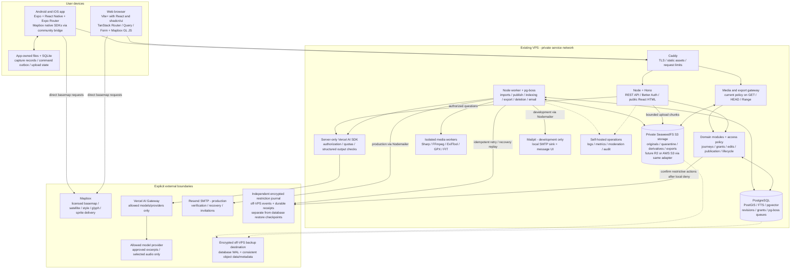
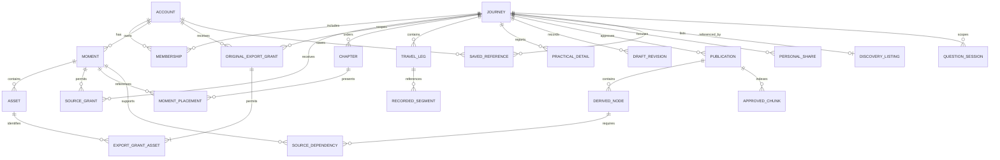
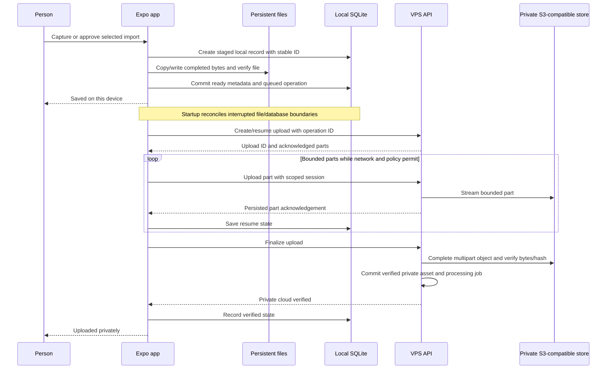
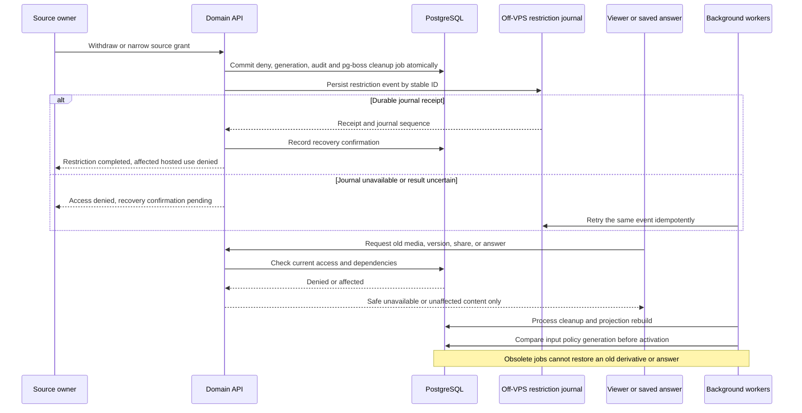
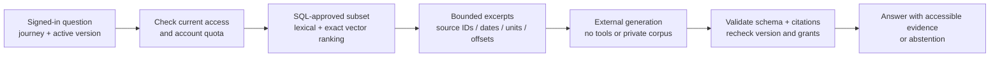

# Application architecture and technology decisions

| Field | Value |
|---|---|
| Version | 1.10 |
| Date | 19 November 2026 |
| Status | Implementation architecture aligned with requirements 2.6 and unified experience 1.2. |
| Product authority | [Product requirements](product-requirements.md), [product plan](product-plan.md), and [application design](application-design.md). Requirements take precedence. |
| Confirmed platform choices | Vite+ with React and TanStack for web. Expo/React Native Android-phone and iPhone development on the MacBook with phone emulators/simulators now; Android public mobile distribution first. Apple enrollment and iOS public distribution deferred. No EAS subscription during development. |
| Confirmed styling | Tailwind/shadcn on web; React Native Unistyles v3 on Android and iOS, backed by the shared design tokens. NativeWind is excluded. |
| Confirmed email choices | Mailpit in development and Resend in production. |
| Selected maps | Mapbox GL JS on web and Mapbox native SDKs through the community React Native bridge. One provider supplies basemaps and satellite imagery. |
| Confirmed file storage | SeaweedFS with an S3-compatible application interface and S3 client, to support a future R2/AWS S3 migration. |
| Initial server baseline | Approximately 4 vCPU and 8 GB RAM for testing, then a larger machine as needed. No fixed launch-user target or capacity promise; detailed server sizing is deferred. |
| Canonical stack location | Section 14 is the sole current technology/dependency register. Other sections explain behaviour, responsibilities and qualification requirements. |
| Confirmed hosting boundary | Existing VPS hosts the application and stored application data. External AI, transcription, and map APIs are permitted. Budget is not the immediate constraint. |
| Deployment inputs | Actual provisioned CPU/RAM, OS, disk, region, existing workloads and off-VPS backup/journal destination are recorded at setup. The 4 vCPU / 8 GB RAM baseline is a plan, not an inspected host. |
| Decision meaning | Recommendations below guide implementation. Numerical limits and operating targets are proposed defaults until measured and adopted. |

## Contents

1. [Recommended architecture](#1-recommended-architecture)
2. [Product constraints that determine the design](#2-product-constraints-that-determine-the-design)
3. [Competitor evidence and lessons](#3-competitor-evidence-and-lessons)
4. [Overall architecture](#4-overall-architecture)
5. [Module ownership and repository structure](#5-module-ownership-and-repository-structure)
6. [Data model and invariants](#6-data-model-and-invariants)
7. [Web, mobile, and TanStack decisions](#7-web-mobile-and-tanstack-decisions)
8. [Durable capture, import, and synchronization](#8-durable-capture-import-and-synchronization)
9. [API, authentication, and shared editing](#9-api-authentication-and-shared-editing)
10. [Media, route processing, and reconstruction](#10-media-route-processing-and-reconstruction)
11. [Publication, access, and revocation](#11-publication-access-and-revocation)
12. [Maps and external processing](#12-maps-and-external-processing)
13. [Search, transcription, and grounded answers](#13-search-transcription-and-grounded-answers)
14. [Canonical stack and dependency register](#14-canonical-stack-and-dependency-register)
15. [VPS deployment and operations](#15-vps-deployment-and-operations)
16. [Implementation dependencies and release evidence](#16-implementation-dependencies-and-release-evidence)
17. [Requirement coverage](#17-requirement-coverage)
18. [Open decisions](#18-open-decisions)
19. [Implementation references](#19-implementation-references)

## 1. Recommended architecture

Build a TypeScript modular monolith with separate HTTP and background-worker processes. PostgreSQL owns canonical journeys, permissions, revisions, publication pointers, search, and durable jobs. Private SeaweedFS object storage on the VPS holds originals and generated files behind an S3-compatible interface and authenticated media gateway. Docker Compose and Caddy run and expose the application. S3 portability is an explicit requirement so file storage can later move to R2 or AWS S3 without rewriting the domain/media API.

Keep Expo and React Native. Their native camera, audio, SQLite, filesystem, and foreground-location support match the agreed product. Use local development builds on the MacBook with Android phone emulator and iPhone Simulator because native map/styling modules require compiled native code. Local builds require no EAS subscription or hosted build service. Dedicated iPad support is outside scope. Apple enrollment and public iPhone distribution remain separate. A browser PWA cannot replace the required native capture durability. Kotlin is the fallback for a demonstrated Android integration problem; Flutter adds another language without solving a known requirement. [Expo build options](https://docs.expo.dev/deploy/build-project/), [mobile development plan](development-and-validation.md).

Use Vite+ as the web toolchain, with React, shadcn/ui, and TanStack Router. Vite+ owns development, building, tests, linting, formatting, and task execution; it does not replace React or TanStack routing. Render approved public stories to HTML so reading and safe social metadata do not wait for the map or client JavaScript. Use TanStack Query and Form in both clients. Keep native navigation in Expo Router.

Use Mapbox for web and native maps, basemap delivery, and satellite imagery. The web uses Mapbox GL JS directly; Expo uses the community React Native bridge to Mapbox's native SDKs. Journey geometry and permissions stay on our VPS. Meter actual provider usage independently of account counts. Section 12.5 defines the usage policy.

Use Vercel AI SDK on the server and Vercel AI Gateway as the actual hosted model gateway. The SDK is an open-source library; the Gateway is a separate external service that can be called from the VPS. Keep selected source files, transcripts, embeddings, question sessions, and retrieval indexes on the VPS. Send only authorized task inputs through the Gateway to explicitly allowed model providers. Use one SMTP transport with Mailpit locally and Resend in production.

All selected products, libraries, versions, service boundaries, and installation stages are consolidated in [section 14](#14-canonical-stack-and-dependency-register).

### 1.1 Architecture decisions

| ID | Decision | Why it fits this product | Alternative and reconsideration trigger |
|---|---|---|---|
| ADR-01 | Modular monolith with isolated workers | Membership, source grants, publication, and withdrawal need consistent transactions. Parsing and video conversion need separate resource limits. | Extract a service when measured isolation, scaling, or team ownership requires it. Independent domain microservices are unnecessary initially. |
| ADR-02 | PostgreSQL with PostGIS, full-text search, and pgvector | One store covers relational authority, route operations, catalog filtering, and journey-scoped retrieval. | Add a search service only when measured query volume or relevance exceeds PostgreSQL's suitable workload. |
| ADR-03 | REST with OpenAPI and generated clients | Installed mobile versions outlive web deployments. Explicit wire contracts support that release skew. | tRPC is credible for a TypeScript monorepo, but compile-time sharing does not make older installed clients compatible. GraphQL adds no demonstrated R1 need. |
| ADR-04 | SQLite plus persistent files and an application sync protocol | A completed capture must survive offline operation, process death, retries, and expired picker access. | Evaluate a sync engine only if it supports these media, grant, conflict, and revocation rules. Query caching alone is insufficient. |
| ADR-05 | Expected revisions and retained conflicts | R1 requires stale-edit detection and recovery, with character-level live coediting deferred. | Add CRDT editing only after the product adopts simultaneous text editing. |
| ADR-06 | Stable approved snapshots with current access checks | Draft edits stay private. Withdrawals and takedowns must override every old version. | Public immutable buckets or permanent asset URLs cannot satisfy this access model. |
| ADR-07 | pg-boss with direct transactional enqueue | Its shipped Drizzle adapter lets domain writes and jobs commit together. No separate generic outbox dispatcher or Redis service is needed. | Add an outbox only for a distinct destination that cannot participate in this database transaction. |
| ADR-08 | SeaweedFS plus a narrow S3-compatible storage adapter | The storage boundary must support future R2/S3 migration. Keep logical object identities and current rights checks independent of endpoints. | Migration changes the storage location/configuration and copies verified objects. Provider-specific API behavior still needs conformance tests. |
| ADR-09 | Vite+ React creator app and a narrow approved-reader renderer | Shared reader/preview components, small public payload, and explicit policy checks. Custom SSR has a real maintenance cost. | Revisit maintained TanStack Start if actual integration/maintenance evidence favours it; apply the same payload, privacy and request-isolation requirements. |
| ADR-10 | Mapbox SDKs and Mapbox basemaps/satellite | One provider covers the required web/native rendering and imagery. Journey overlays need no routing or hosted tileset service; meter SDK usage under the actual account terms. | Qualify the community native bridge, actual usage, coverage, attribution, and terms during implementation. Reconsider only for a demonstrated integration, coverage, or operating problem. |
| ADR-11 | Vercel AI SDK plus hosted AI Gateway | One SDK handles bounded generation, embeddings, and transcription; one actual gateway handles provider routing. VPS deployment remains independent of Vercel hosting. | Use a self-hosted gateway if operational/privacy needs require owning that proxy. Avoid two SDKs or gateways for the same work. |
| ADR-12 | Nodemailer SMTP with Mailpit/Resend | One transport implementation supports the confirmed development and production choices. | Add a Resend HTTP SDK only if a required API-only capability appears. |

### 1.2 Whole-system alternatives considered

| Candidate | Benefits | Cost for these requirements | Decision |
|---|---|---|---|
| TypeScript modular backend, PostgreSQL, private S3 objects, workers, explicit client sync | One permission authority, portable deployment, shared contracts, independently bounded heavy work. | Own the upload/sync protocol, viewer-safe projection, and public rendering integration. | Recommended. |
| Self-hosted Supabase plus React and Expo | Packaged authentication, PostgreSQL, storage, and realtime. | More services to operate. Its packaged APIs still require custom source grants, publication snapshots, dependency invalidation, and mobile file/outbox handling. | Viable, but adds machinery without removing the difficult product rules. |
| Full local-first replication with CRDT documents and a sync service | Attractive reactive collaboration and offline documents. | Must govern replicated private material, revoked grants, media durability, schema evolution, and approved snapshots. Character-level collaboration is outside R1. | Defer until a demonstrated need outweighs the additional sync authority. |

### 1.3 Backend alternative boundary

Retain PostgreSQL and the modular backend as the single journey/permission authority. Adding another backend only for realtime would duplicate access, recovery and synchronization responsibilities. A managed or self-hosted reactive backend is a future whole-system alternative, not an additional R1 component. The selected system still owns native file durability, source grants, safe publication, media processing and deletion. No competitor's private stack establishes a performance requirement for this application.

## 2. Product constraints that determine the design

| Requirement | Architectural consequence |
|---|---|
| One event, five participants, one canonical journey | Membership/history, public profiles, bookmarks, listings, and personal shares reference one journey ID. They do not copy it. |
| Capture survives offline use and restart | Persist a file and a recoverable SQLite record before acknowledging success. Maintain an explicit outbox and startup reconciliation. |
| A member can contribute without publishing | Keep ownership, journey-review grants, publication reuse, editing capabilities, and publishing capabilities separate. |
| Ordinary edits stay private until republishing | Draft revisions and approved versions are separate records. Readers resolve an active approved pointer. |
| Withdrawal overrides old versions and answers | Record source dependencies, commit an authoritative deny, and recheck current policy at every managed delivery point. |
| Optional GPS and truthful geography | Preserve segmented recordings, missing timestamps, participant branches, estimated geometry, and unknown gaps independently. |
| Story must load before maps and heavy media | Server-render useful public text, serve derivatives progressively, and lazy-load map/player code. |
| Historical, source-grounded learning | Store observation dates, units, source evidence, and accessible citations. Keep current-world browsing out of journey answers. |
| Complete R1 build | Search, questions, export, lifecycle controls, moderation, and operations are required workstreams. Internal build order is not a reduced public release. |

No continuous recorder, background location tracking, navigation, SOS, bookings, social feed, preparation planner, independent participant stories, or per-share answer indexes enter this architecture.

## 3. Competitor evidence and lessons

First-party [Polarsteps collaboration](https://support.polarsteps.com/hc/en-us/articles/24266906223506-How-to-add-photos-and-videos-with-Travel-Together), [FindPenguins shared-trip guidance](https://support.findpenguins.com/hc/en-us/articles/11252160527516-Tips-for-trips-with-fellow-travelers), and [RouteTale workflows](https://routetale.app/docs/) establish overlapping capabilities. They do not establish competitors' latency, private data model, adoption, or architecture suitability here.

The founder's direction is a unified, responsive experience. The architectural consequence is shared contracts and context, a bounded default story, immediate readable output, native controls, lazy heavy features, and measurable operation costs. The [product plan](product-plan.md#4-positioning-and-comparisons) defines the corresponding product decisions. Competitor technology lists are not an installation plan or a reason to add services.

## 4. Overall architecture



The Node service is one deployment unit containing domain modules, HTTP transport, and public rendering. The media gateway can be a separate process using the same policy implementation if traffic warrants it. Workers reuse domain policy where appropriate but run slow operations outside request handling. The operations box describes responsibilities, not a requirement to install every monitoring component on a small VPS.

Public clients never connect directly to PostgreSQL or the private object store. The upload path is a bounded authenticated gateway. Caddy exposes no raw bucket/object route that bypasses source permissions. Basemap traffic goes directly to the provider under its terms; journey geometry remains an application payload. Mailpit runs only in development, and no Vercel app hosting is required to use AI Gateway.

The restriction journal can use the off-VPS backup destination once configured, through a separate append/checkpoint interface and retention policy. It preserves restrictive events outside the database's rollback point. It is a recovery record, not another live journey database. Section 15.4 defines receipts, pending confirmation, replay, and closed recovery access.

## 5. Module ownership and repository structure

### 5.1 Domain responsibilities

| Module | Owns | Representative operations |
|---|---|---|
| Identity | Auth integration, private/public profile separation, sessions, recovery. | Register, recover account, revoke device session, select public profile fields. |
| Journeys | Canonical event, membership references, invitations, capabilities, archival. | Create, join once, change capability, accept transfer, leave. |
| Sources | Personal moments, originals, provenance, sharing/export grants, uploads, source withdrawal. | Begin/finalize upload, contribute, narrow grant, grant/revoke recipient-specific original export, compute removal impact. |
| Editorial | Chapters, moment placement, narrative blocks, revision history and conflicts. | Apply an expected-revision command, compare candidates, restore with current grants. |
| Geography | Stops, segments, participant legs, geometry provenance, statistics. | Normalize recording, associate a moment, select primary track, redact geometry. |
| Knowledge | Dated practical details, author reports, reviewable extraction. | Confirm a sourced cost, amend a report, inspect source dependency. |
| Publication | Review blockers, safe projection, approved version, visibility, source manifest. | Preview, publish, republish, unpublish, invalidate affected derivatives. |
| Sharing | Approved personal selections, hosted links, static cards. | Select eligible highlights, generate card, revoke hosted presentation. |
| Discovery | One listing per event, moderation, filters, saved references, profile eligibility. | Submit listing, review/report/remove, save private note, reference a future event. |
| Answers | Approved chunks, embeddings, question sessions, citations and abstention. | Index approved passages, retrieve within a journey, validate and serve an answer. |
| Lifecycle and operations | Export, deletion, retention, audit, quotas, notices, job support, restriction-journal receipts and recovery. | Export permitted sources, confirm journal persistence, purge eligible data, replay restrictions before enabling restored access. |

Each module hides its database queries and policy decisions. HTTP handlers call a complete domain operation instead of coordinating grants, file writes, publication updates, and audit records themselves. Workers call explicit operations such as generating a proposed derivative or finalizing a publication. They cannot directly mark arbitrary files public.

### 5.2 Monorepo layout

```text
apps/
  web/                 Vite+ React creator and public renderer/client entries
  mobile/              Expo native screens, capture, SQLite, sync engine
  server/              Hono API, auth, public HTML, upload/media gateway
  worker/              Node pg-boss consumer, media jobs, AI and email calls
packages/
  contracts/           Zod wire schemas, OpenAPI, generated client types
  backend/             Server-only domain modules, policy, Drizzle data and jobs
  shared/              Pure chronology, evidence, money, and URL-selection rules
  sync-protocol/       Versioned commands, acknowledgments, conflicts, tombstones
  design-tokens/       Shared semantic colour, typography, spacing and motion tokens
tests/fixtures/        Consented media, GPX/FIT, permission and answer corpora
infra/
  compose/             Service definitions, health checks, resource limits
  images/              Reproducible server and sandbox worker builds
  operations/          Backup/restore, release, moderation, and incident runbooks
docs/
```

Use pnpm workspaces through Vite+'s package-management and task commands. Keep web/native UI components inside their applications until actual cross-application reuse warrants a package. Do not add a second monorepo task runner. Clients may import contracts and pure rules, never database tables, server auth configuration, secrets, or backend repositories. Shared React code must not bundle another React. Mobile and web can resolve different SDK-compatible React versions.

## 6. Data model and invariants

### 6.1 Principal relationships



This diagram shows logical relationships, not finished SQL. A segment retains its imported-file identity and can be associated with multiple chapter/leg ranges through joins. Membership capabilities, leg participants, public-profile selections, invitation/transfer records, upload sessions/parts, answer citations, jobs, audit events, and dependency edges also need explicit records.

### 6.2 Storage rules

| Concern | Required representation and constraint |
|---|---|
| Identity | Client-generated UUIDs for offline objects and operations. Unique membership by account and journey; unique listing by journey; unique saved reference by account and journey. Historical participation does not bypass current access. |
| Roles | Separate administration, coauthoring, and publishing capabilities. Review of others' contributed sources and draft reads require active coauthor or publisher membership. Editing requires coauthor capability. Administration alone grants none of these data rights. The creator initially holds all three capabilities. |
| Source scope | A moment has an owner; each journey contribution has an explicit review or publication-reuse grant and revision. Absence of a grant means no journey access. Follow the requirements capability matrix. Withdrawal has its own durable deny record. |
| Original-file export | An owner-issued grant identifies its owner, active recipient member, journey, exact asset IDs, source-grant revisions, creation time, expiry, and revocation state. Asset membership is explicit, not an unbounded future-upload grant. Owner-only sources are ineligible. Generation and every managed download recheck all grant conditions. |
| Restriction recovery | Stable restriction event ID, ordered journal sequence, affected opaque IDs, restrictive operation, policy generation, integrity digest, and durable receipt. Commit the local deny/audit/retry job together; record independent off-VPS confirmation before reporting successful completion. Store no source media, text, or coordinates in the journal. |
| Time | UTC instant when known, original local timestamp/offset, IANA timezone context when known, source, confidence, and manual corrections. A missing timezone stays unknown. Capture, upload, entry, observation, and edit times are distinct. |
| Geography | PostGIS line segments and points with evidence category, accuracy, source file, participants when known, and correction provenance. Preserve raw samples separately from display simplification and redacted output. |
| Money | Exact decimal amount and currency code, with unit, group size, inclusions, observation date, and estimate flag. Decimal amounts cross JSON as strings. |
| Editing | Entity revision and journey draft generation. Retain changed blocks, actor, server time, base revision, and a candidate for conflicts. Reordering uses stable item IDs and explicit ordered membership. |
| Publication | Immutable approved content version, policy generation, redaction configuration, source/dependency manifest, derivative states, and one active pointer on the journey. Visibility and listing state are separate. |
| Personal shares | Journey ID, approved source version, eligible moment references, cover, approved attribution, and personal caption. No copied journey, chronology, listing, or retrieval corpus. |
| Derived claims | Every generated statement, thumbnail, transcript excerpt, practical suggestion, share card, or index chunk records its source dependencies and generation. An untraceable derived claim is ineligible for publication. |
| Questions | Account-scoped session, one journey, approved version/generation, prompt/model/retrieval revisions, citation records, and disclosed retention. Stored answers recheck current access. |
| Processing | Idempotency key, input hash/version, state, attempts, next retry, timeout, cancellation generation, output references, and safe error code. |
| Storage portability | Asset ID plus logical object key, storage-location ID, byte length, checksum, content type, and transformation/policy version. Bucket/endpoint/region/credentials belong to storage configuration; never persist expiring signed URLs as asset identity. |

Use foreign keys and uniqueness constraints for identity rules. Enforce unique grant/asset membership and valid source-owner, recipient, journey, and asset relationships. Validate current membership and grant revisions transactionally at use. Index permission joins and foreign keys used in access/deletion paths. Use B-tree indexes for journey/status/date filters, GIN for full-text search, trigram indexes where useful, and GiST for spatial queries. Start with exact vector ranking inside the authorized journey subset; introduce HNSW only after measuring it. Review PostGIS and vector SQL explicitly rather than forcing every operation into ORM helpers.

Apply row-level security to private domain tables as defense in depth. Use non-owner runtime roles without `BYPASSRLS`, transaction-local verified account context, and `FORCE ROW LEVEL SECURITY` where appropriate. Application policy still decides publisher capability, source reuse, and viewer projections. Keep auth-library tables under their own least-privilege access strategy; do not assume a generic journey RLS policy fits authentication internals. Never accept account context from request JSON. [PostgreSQL row security](https://www.postgresql.org/docs/18/ddl-rowsecurity.html).

## 7. Web, mobile, and TanStack decisions

### 7.1 Vite+ and web delivery

Use Vite+ for the React application's development, client/server builds, tests, static checks, formatting, and workspace tasks. Use the adopted release's supported configuration and test imports. Enable both type-aware and type-check options for the intended static checks. Expo Metro and native builds remain separate tasks. [Vite+ guide](https://viteplus.dev/guide/), [checks](https://viteplus.dev/guide/check).

Keep the React and TanStack Router plugins. Use the adopted Vite+ release's documented package-manager configuration so plugins resolve a compatible Vite core and runner. Retain generated aliases only where that release requires them; add a peer exception only for an evidenced compatibility need under section 14.2. Do not ignore unrelated peer errors. [Local CLI and compatibility setup](https://viteplus.dev/guide/local-cli).

Build two entries from shared web components:

- The creator application uses TanStack Router and Query, with validated URL state for journey, view, chapter, moment, and filters. Private data loads only after verified access.
- A bounded public React renderer in the Node service resolves the approved journey and typed URL selection, then renders useful story HTML and safe Open Graph metadata. Its client entry hydrates the same component tree and progressively adds map, playback, source, and question controls.

Use one viewer-safe data contract and component family for public rendering and publisher preview. Ordinary links preserve view/chapter selection and work before client enhancement. Keep server rendering limited to this approved reader rather than building a general rendering framework. Use Vite+'s production client/server builds and manifest, request-local rendering/Query state, safe serialization, and the actual Node entry. Its development server never serves production traffic. [Vite SSR integration](https://vite.dev/guide/ssr).

Initialize a map only on an explicit map action, such as opening Explore, opening the route editor, or choosing to show a Story map. Story reading, scrolling, and idle time do not create a map instance or basemap requests. Reuse the current instance across chapter/style changes where appropriate.

The narrow renderer has an explicit maintenance cost. Current [TanStack Start hosting guidance](https://tanstack.com/start/latest/docs/framework/react/guide/hosting) documents deployment choices. Keep the selected renderer for now and compare a maintained Start integration only if it reduces demonstrated maintenance without expanding reader payload or weakening policy checks. Test production HTML/hydration, request isolation, lazy chunks and unavailable metadata; toolchain choice alone is not runtime performance evidence.

After revocation, server-render generic unavailable content and metadata. R1 uses `noindex` because external indexing is later scope. Unlisted credentials require access checks, safe logs, and a `no-referrer` policy; search-engine directives are not access control.

### 7.2 Native delivery and shared UI rules

Develop both phone platforms on the founder's MacBook. Use iPhone Simulator and Android phone emulator; install and record compatible Xcode/Android SDK/Expo runtime versions when setup begins. Record the actual Mac architecture and installed toolchain during setup. No dedicated iPad application or qualification is in scope. Production stays on the VPS. The [development and validation plan](development-and-validation.md) separates simulator fixtures, hardware-only behaviours, and public distribution.

Expo Router owns native screens/deep links. App-owned files and SQLite own captures, unsent edits, upload progress, and sync cursors. SecureStore owns session secrets. Query owns fetched server state with focus/connectivity integration. It never owns the only copy of a capture. [Query React Native integration](https://tanstack.com/query/latest/docs/framework/react/react-native).

Use owned shadcn components with Tailwind on web and React Native controls styled with **Unistyles v3** inside the Expo app. This is the confirmed mobile styling choice; do not introduce NativeWind. Share palette, typography, spacing, evidence language, and pure rules through the platform-neutral `design-tokens` package. Keep Unistyles configuration and styles inside `apps/mobile`; do not share DOM components or add native dependencies to the token package. Use the approved self-hosted typefaces with system fallbacks and a bounded font payload. Web primitives use shadcn’s Base UI registry and Fold’s web-specific role values. The [Fold contract](../../DESIGN.md) owns their states, typography and interaction rules. [shadcn introduction](https://ui.shadcn.com/docs), [Unistyles setup](https://www.unistyl.es/v3/start/getting-started/).

Unistyles enters the mobile foundation with its Nitro Modules dependency, the New Architecture, and a local development build. It does not run in Expo Go, so compiled builds are required before Mapbox is introduced too. Configure the supported Babel plugin with `babel-preset-expo`, a source root covering native components, and explicit processing of route files outside that root where necessary. Initialize the token-backed theme and breakpoints in a custom entry before importing `expo-router/entry` or any module creating a Unistyles stylesheet. Keep the experimental Metro integration out of the baseline and never enable both transform integrations. Import `StyleSheet` directly from `react-native-unistyles`, retain reactive styles through style arrays, and qualify themed props on Mapbox/other third-party native views. [Babel integration](https://www.unistyl.es/v3/other/babel-plugin/), [Expo Router initialization](https://www.unistyl.es/v3/guides/expo-router/).

CSS transitions cover the requested subtle web animation. Native uses built-in interaction primitives and the SDK-compatible navigation/gesture modules required by selected screens. Keep the design's reduced-motion behavior, modest transition durations, user-started playback, and map-independent reading. A separate web animation library is unnecessary initially.

### 7.3 TanStack dependencies with a current job

| Library | Product responsibility | Platform and installation stage |
|---|---|---|
| Router and its build plugin | Typed creator routes and validated view/chapter/moment URL state. | Web foundation. Expo Router handles native navigation. |
| Query | Fetched data, pagination, processing status, invalidation, account-scoped questions. | Web/native foundation; no durable-media or command-queue guarantee. |
| Form | Journey setup, practical details, permissions, and review forms using shared Zod inputs. | Add with those forms on web/native. |
| Table | Bulk-import review and moderation where sortable/selectable tables help. | Add with the web import/review workspace, not native screens. |

Section 14 governs dependency selection and version qualification. A third-party virtualizer requires a measured bottleneck. TanStack Start and TanStack AI are alternatives, not additional selected frameworks.

### 7.4 Experience performance architecture

Implement UX-01, UX-02 and PERF-01 against the [experience budgets](application-design.md#10-experience-and-performance-acceptance). Public reading renders useful HTML without waiting for hydration, map loading, authentication or AI. Split creator/editor, map and large media controls into separate chunks; do not bundle server/provider SDKs into clients. Preload only the likely initial text/cover/font resources, with responsive image sizes and reserved aspect ratios. Never lazy-load the actual LCP image blindly.

Use one selected journey/view/chapter/moment state contract in URLs and native navigation. Resolve a safe return action after authentication and restore list position/filter state on back. Mount one map only when requested; retain it across day/style changes where appropriate and release it on leaving the owning surface. Only one media player runs at a time. Pause work when the view/app is not active.

Native collections use FlatList/SectionList with stable keys, bounded paging, thumbnails and fixed item measurements where valid. Do not use an unbounded ScrollView for hundreds of media items. Profile before adding a recycler library; use stable layouts where valid. [React Native list guidance](https://reactnative.dev/docs/optimizing-flatlist-configuration). Web bulk grids may use measured windowing; readable stories keep accessible anchors and browser find behaviour through progressive chapter delivery rather than virtualising away all narrative. Heavy parsing/transcoding stays off the interactive thread.

Expo Image supplies downscaled image rendering and recycled-view identity. Its default disk cache is not an access control: use no implicit disk cache for protected remote media; an application-owned account/asset/policy-version cache must enforce expiry, access revalidation and clearing. Cache only the user's own durable captures independently of shared grants. Clear query/image/view state on logout; revalidate shared state on reconnect. Client caches do not make old grants authoritative. [Expo Image caching and recycling](https://docs.expo.dev/versions/latest/sdk/image/).

Configure Query by data class: owner-local data lives in the outbox, visible network reads use bounded stale/refetch intervals, and grants/restricted operations require fresh server checks. Do not set permission data permanently fresh, persist private Query payloads by default, or let retries multiply mutation/AI work. Poll visible jobs/notices with backoff and stop when complete/backgrounded. Preserve already shown authorised content during harmless refresh without displaying data from another account. Configure stale/refetch/retry behaviour deliberately rather than inheriting it implicitly from [Query defaults](https://tanstack.com/query/latest/docs/framework/react/guides/important-defaults).

Measure public initial payload, LCP/INP/CLS, route transitions, large-list frame traces, memory/player/map cleanup, API query counts and queue age on the declared fixtures. Document development-emulator versus physical-device evidence. Do not claim one state library, styling system or compiler automatically makes the application faster.

## 8. Durable capture, import, and synchronization

### 8.1 Local save protocol



Filesystem and SQLite writes do not form one atomic transaction. Use staged states, deterministic file paths, verification, and startup repair. A completed local save requires a durable file and committed metadata/outbox references. Clean orphaned temporary files only after reconciliation; preserve the last confirmed copy. Do not depend on picker cache files, an expiring content URI, or AsyncStorage for bulk media. [Expo SQLite](https://docs.expo.dev/versions/latest/sdk/sqlite/), [Expo FileSystem](https://docs.expo.dev/versions/latest/sdk/filesystem/).

Capture does not wait for location, upload, transcription, or AI. Bound the foreground location attempt and preserve its measurement age and accuracy. Denial, approximate access, a stale fix, or no result yields an explicit unknown/approximate state. There is no background location request or idle polling.

### 8.2 Sync protocol

Use stable client object IDs and command IDs, server revision expectations, an upload session with acknowledged parts, and a scoped incremental change cursor. The server records each accepted command result by account/device/operation identity. Retries return that result rather than repeating side effects. Deduplication lifetime must cover the supported offline-retry period; an expired command still meets unique object and revision constraints.

Persist progress after each acknowledged part. The gateway authorizes the request, streams the bounded part to the private S3-compatible store, and records its upload/part identity, length, and checksum. On restart, reconcile persisted state with the store's part listing. Finalization completes the multipart upload and verifies object size and a real whole-file checksum before committing the verified asset and processing job. Do not treat a multipart ETag or client-supplied metadata as a verified whole-file hash. If the provider cannot validate the required checksum, stream-read the completed private object for verification without buffering it in memory. Object completion and the database commit are not one atomic transaction; reconcile orphaned objects and incomplete metadata. Expired sessions explicitly abort unfinished multipart uploads. [Multipart upload behavior](https://docs.aws.amazon.com/AmazonS3/latest/userguide/mpuoverview.html).

Detect exact duplicate imports using a cryptographic content hash scoped to the owner and destination. Within that scope, reuse the verified asset/reference instead of counting a retry as another moment. Reusing an owner's asset in another journey still requires a distinct explicit grant. Never expose cross-owner hash matches or use a matching file to infer ownership, identify another person's upload, or grant access.

Sync changes include membership/grant changes, entity revisions, deletions, and access tombstones. A stale client that has fallen outside retained change history performs an authorized full resync without discarding unsent work. Revoked access stops uploads/contributions and clears cached shared data when the app reconnects. Offline devices and already downloaded files cannot be remotely erased; disclose that boundary.

Separate state axes rather than forcing them into one enum:

- Local persistence: staging, saved, missing, failed.
- Transfer: queued, uploading, paused, verified private cloud, failed, cancelled.
- Source access: owner only, journey review, publication reuse, withdrawn.
- Publication inclusion: absent, included in approved version, suppressed by current policy.

The interface uses the current experience brief’s plain state names and distinguishes verified upload from independently recoverable backup. Cancelling an upload preserves the local original. Explicit retry, Wi-Fi preference, quota waits, expired sign-in, and reselection of missing sources have visible states.

Foreground sync is the reliable default. Expo BackgroundTask is opportunistic, with Android scheduling controlled by the OS and a minimum periodic interval of 15 minutes. Force-stop can prevent execution until the app restarts. If required transfer behavior needs WorkManager or a foreground service, implement a bounded native Expo module inside this production application. Never promise immediate uploads after termination. [Expo BackgroundTask](https://docs.expo.dev/versions/latest/sdk/background-task/).

Apply the same durable outbox/retry contract on iOS, with its own OS scheduling and permission behavior. Android-specific transfer code does not establish iOS behavior. Test foreground retry, interruption, relaunch, and available background execution in iPhone Simulator with unavailable hardware cases recorded; do not promise immediate background completion on either platform.

### 8.2.1 Account isolation and device restore

Account ID is part of every local database/file namespace, outbox operation, query key and upload session. Authentication changes first stop dispatch and cancel account-scoped requests, then clear protected rendered/cache state. A queued command must authenticate as its immutable owner; never rewrite its ownership to the next logged-in account. Keep unsent originals in a separate inaccessible owner partition until that owner reauthenticates or explicitly exports/removes them. Revoked journey membership stops contribution, not recovery of personal captures.

Declare Android backup/data-extraction rules and iOS backup exclusions for local data classes. Exclude reconstructible shared caches, session material and device-bound state. Local-only source preservation and OS-copy boundaries must be disclosed. On a detected restore/reinstall or inconsistent local identity, authenticate, establish a new device identity, reconcile file/outbox integrity, and fetch current permissions before rendering shared cached data or retrying operations. Existing operation IDs remain stable for server deduplication. SecureStore and filesystem/SQLite restore are not assumed atomic.

Validate account A → logout → account B with pending offline work, and old-device restore after a source/member revocation. Android/iPhone simulator fixtures cover protocol behaviour; actual OS backup/transfer behaviour is a separate evidenced test. [Android backup](https://developer.android.com/identity/data/autobackup), [SecureStore](https://docs.expo.dev/versions/latest/sdk/securestore/).

### 8.3 Imports and web recovery

Use the Android system picker for selected photos/videos and document selection for audio/GPX/FIT. Copy approved selections into app-owned storage before queuing them. Recover Android picker activity results, including `getPendingResultAsync`, and report cloud-provider, expired-access, and individual codec failures. Date suggestions inspect permitted selected metadata locally before upload. Wider-gallery date discovery remains conditional and never silently uploads candidates. [Expo ImagePicker](https://docs.expo.dev/versions/latest/sdk/imagepicker/).

Use the corresponding iPhone media/document selection through the adopted Expo modules. Verify limited or denied access, cloud-backed selections, original metadata, and copying to persistent app-owned storage in iPhone Simulator with hardware/library limitations recorded. Native platform adapters share protocol/state rules without assuming identical permission or picker lifecycles.

For web drafts, use Dexie/IndexedDB to persist unsent text commands, base revisions, and supported selected-file state. Request persistent storage where available, show unsent edits, and provide recovery/export before destructive navigation. Browser eviction, cleared site data, and expired file handles limit guarantees. Reopening the browser may require reselecting an upload. Android and iOS are the declared durable capture platforms; Query's persisted cache is not a substitute for either client's outbox.

## 9. API, authentication, and shared editing

### 9.1 HTTP contracts

Use versioned `/api/v1` contracts, Zod validation, OpenAPI generation, and `openapi-typescript`/`openapi-fetch` clients. Keep wire schemas separate from database rows. Parse external input at the boundary and use explicit variants for evidence, missing time, access, and processing state. Authentication retains its own `/api/auth` handler.

Web, iOS, and Android use the same backend operations and response schemas through `@kairn/contracts`. This also applies when a feature ships on web first. The backend owns canonical validation, permissions, processing, calculations, and state changes. For journeys this includes GPX inspection and route measurements, invitation delivery, recording attachment and access, and deletion. Clients own presentation, input collection, and transport details such as session handling, file selection, and upload progress. Client-side validation may give immediate feedback while the backend enforces the same rules for every caller.

For each web-first feature, put new shared operations under `/api/v1` and verify them independently of browser UI. Regenerate and check OpenAPI and the generated client when the wire contract changes. Preserve existing routes and request and response compatibility for installed builds. A same-origin web proxy can forward requests to the shared backend. The feature's business logic belongs behind the versioned contract where native clients can call it directly.

| Operation | Contract behavior |
|---|---|
| Upload initiation/parts/finalization | Scoped session, quota reservation, acknowledged parts, checksum verification, one resulting asset. |
| Draft entity edit | Expected entity revision, command ID, validated patch, actor, and current access. |
| Publication request | Exact reviewed draft generation, source-grant/redaction generation, requested visibility, and publisher capability. |
| Incremental sync | Authorized changes/tombstones after an opaque scoped cursor, with explicit cursor-expired recovery. |
| Viewer read/source/media | Current active approved version and policy; generic unavailable result when inaccessible. |
| Question | Signed-in account, canonical journey and version, bounded question, authorized citations, rate/usage accounting. |
| Lifecycle action | Fresh session when appropriate, impact preview token tied to current state, explicit action, and auditable result. |
| Restrictive action completion | Immediate local deny. Report success only after the independent journal receipt; return a visible pending-recovery-confirmation state when persistence is incomplete. Retry by the same event ID. |

Use cursor pagination for histories, discovery, sources, and jobs. Use `ETag`/`If-Match` for entity revision checks, with `412 Precondition Failed` for a stale precondition and a retrievable conflict candidate. A semantic conflict can use `409 Conflict`. Errors follow RFC 9457 Problem Details without private fields. Return retry guidance for rate limits and processing states. [HTTP conditional requests](https://datatracker.ietf.org/doc/html/rfc9110#section-13.1.1), [Problem Details](https://www.rfc-editor.org/rfc/rfc9457).

Installed apps need compatible additive changes, explicit minimum-supported protocol versions, and versioned destructive changes. Validate old-client fixtures during server releases. A shared TypeScript build cannot test an already installed binary.

### 9.2 Authentication and permissions

Use Better Auth with PostgreSQL-backed sessions and the Expo integration. Start with verified email/password, email recovery, device-session revocation, and fresh-session checks for sensitive operations. Social login or passkeys can be added deliberately without changing journey identity. Native session secrets live in SecureStore; browser sessions use secure HttpOnly cookies. Keep CSRF and origin checks enabled, trusted origins exact, and reverse-proxy headers trusted only from Caddy. Disable cookie/session caches that can bypass current server-side revocation. Server recovery invalidates old sessions and authentication tokens under the independent recovery-epoch policy in section 15.4. [Better Auth Expo integration](https://better-auth.com/docs/integrations/expo), [security guidance](https://better-auth.com/docs/reference/security).

Do not use an auth organization plugin as the journey authorization model. Evaluate membership capabilities, source ownership, source grants, publication visibility, active version, and takedown state server-side. Revoking a member blocks protected editing/export/share creation without claiming a public story is now secret from that person.

Use [requirements section 2.5](product-requirements.md#25-capability-and-source-access-matrix) as the authorization matrix. Active coauthors and designated publishers can review contributed sources and read the draft; only coauthors edit it. An ordinary participant has no review-pool or draft access. Source owners retain their own access and grant controls. Administration and publication never confer another contributor's raw-original export rights. Enforce the separate [original-file export contract](product-requirements.md#26-original-file-export-grants) on archive generation and managed downloads, including range requests.

The current web release gates workspace routes in the creator shell and checks a current verified session before rendering Story on the server. Public reading and discovery can open with the publication release. Questions, bookmarks, private history, creation, contribution, and personal-share creation require sign-in. Unlisted links are forwardable bearer credentials, not member authentication. Generate high-entropy tokens, store their hashes, support rotation/revocation, and exclude them from analytics, logs, and referrers. Separate the discoverable public route from unlisted access resolution.

Rate-limit authentication, invitations, uploads, exports, public reads, reports, and questions. PostgreSQL-backed counters and Caddy connection/body limits are sufficient for the initial single-VPS topology. Reserve account-level usage before expensive jobs and reconcile actual usage afterward. Redis is not required just to introduce quotas.

### 9.3 Coauthor editing and notices

Use per-entity optimistic concurrency rather than one lock for the whole journey. Any accepted edit also advances the journey draft generation used by publication review. Store a revision or changed block and audit actor. On stale write, retain the attempted candidate in a separate committed conflict record, return the current value/base revision, and let the user compare, replace after rebase, or combine manually. Rejecting the update must not roll back the saved candidate too.

Autosave queues durable commands with explicit status. Network retries cannot silently replace another member's accepted changes. A restore creates a new revision and runs current source/grant checks; it never restores old permissions. Reordering, splitting/merging chapters, and changing source placement also use expected revisions.

Use a persistent in-app notice/change feed for invitations, withdrawal, conflicts, roles, publication, listing, and transfer. Poll on focus and at a modest interval. Optional SSE can improve online freshness, with authorization, reconnect, and polling fallback. A websocket service, presence system, or CRDT backend is unnecessary for R1 correctness.

### 9.4 Action requests, metadata and bounded recovery flows

Persist permission/detail requests with exact source revisions, journey, sender, recipient, expiry and terminal state. Deep links identify a request but never confer its grant. Authentication returns only to an allowlisted action; acceptance rechecks scope and current authority. Reminder jobs reference request IDs and suppress obsolete or opted-out mail. Follow COL-11 limits and retain a no-response path that excludes unapproved material.

Persist listing metadata as a publisher-approved projection, with destination/alias/title weights and a small editable alias vocabulary. Unknown fields stay unknown. Clarification requests are private, rate-limited and tied to a card/source/version; only deliberate review and republication update public knowledge.

Duplicate recovery selects an explicit destination and reuses only the acting owner's source asset identities with fresh destination grants. Retiring a duplicate requires current admin/publication authority. Do not merge memberships, source rights or other contributors' originals by inference.

## 10. Media, route processing, and reconstruction

### 10.1 Processing pipeline

After finalization, queue actual-type inspection and bounded metadata extraction. Preserve the original unchanged. Generate owner/private previews first; create public derivatives only under a valid publication job. Use deterministic keys containing source identity, input hash, transformation version, and policy generation.

Use Sharp for images, ExifTool for metadata, FFmpeg/ffprobe for media normalization, `fast-xml-parser` plus an owned GPX normalizer, and the official Garmin FIT decoder. The worker image's codec build determines accepted formats. JPEG/PNG/WebP, tested Android/iOS camera output in declared formats, supported MP4 clips, and M4A/MP3/WAV are the baseline. Ordinary iPhone HEIC/HEIF and bounded HEVC/MOV imports require a qualified conversion path for IMP-10. Build the codec-capable worker image and test real fixture profiles before claiming support; a stock Sharp binary or an MP4 extension does not establish decoder support. Use controlled SDR/sRGB-compatible derivatives with tested orientation and colour handling, preserving originals and metadata privately. Keep playable source media available when transcription fails. [Apple HEIF/HEVC guidance](https://support.apple.com/en-us/116944), [Sharp binary format support](https://sharp.pixelplumbing.com/install/) and [HEIF codec requirements](https://sharp.pixelplumbing.com/api-output/#heif) inform the input/build matrix; installation alone does not prove HEIC decoding.

Run untrusted decoders in non-root containers or sandbox processes with CPU, memory, wall-time, output-byte, and temporary-disk limits. Disable unnecessary network access and pass local paths through argument arrays. Reject XML DOCTYPE/entity declarations and impose depth/point limits before GPX normalization. Never pass a submitted URL to FFmpeg. The job coordinator, not an untrusted parser, receives AI credentials and external network permission.

Simple social cards use Sharp for approved photographs, bounded typography, and a safe SVG/text layer. Escape submitted text and disable arbitrary remote image/SVG references. No browser-rendering service or cinematic pipeline is required. Cards include approved attribution and a canonical journey reference. They omit basemap imagery by default because export rights differ from interactive rendering.

### 10.2 Route integrity

Retain GPX tracks and segment breaks, optional timestamps/elevation, and FIT activity provenance. Reject unsupported planned-route-only inputs clearly. A recording can span several chapters; a chapter can contain several recordings. Preserve a geometry-only track when time is missing. Do not fabricate timestamps, snap incompatible moments to a route, connect gaps, or infer that every contributor followed every leg.

Store recording distance separately from estimated transport distance. Select one primary recording for an overlapping group leg and retain alternatives without adding their distances again. Use geodesic calculations, preserve raw samples, and simplify a separate display geometry with a declared tolerance. Test antimeridian crossing, invalid coordinates, split parties, missing elevation, duplicate recordings, and large files.

Public redaction changes geometry, bounds, pins, precision, text, labels, thumbnails, and metadata before serialization. Hiding a marker in the UI is insufficient. A home location can also appear in an image or transcript; the privacy review must exclude that content when coordinate generalization alone cannot protect it.

### 10.3 Reconstruction

Implement deterministic chronology and grouping first, followed by bounded source-linked model suggestions. Retain input metadata, proposed values, evidence category, and accepted/rejected author corrections independently. Regeneration never overwrites an explicit author decision.

Represent recorded route, captured stop, author-reported travel, estimated connection, and unknown movement separately. A reported train leg need not have a line. Estimated provider geometry remains estimated. Rest days and missing recordings remain valid stages. Preserve participant-specific departure/return branches inside the same canonical journey. OCR, image-based place suggestions, and calculated routing stay conditional, with manual corrections and labelled gaps as the complete fallback.

## 11. Publication, access, and revocation

### 11.1 Publication transaction

Visibility is members-only, unlisted or public. Members-only reads require active membership but expose only the approved safe projection, not draft/review/source-original data. All three audiences use the same publication pointer and current source grants. The publisher may widen only after reviewing the exact version and consent semantics; old narrower grants are not upgraded silently. Members-only personal links remain authenticated and cannot generate external social-card downloads. R1 has no separate simultaneous private/public factual publications.

The publisher reviews a viewer-safe preview identified by draft generation and current rights/redaction generation. A publish request verifies publisher capability, source grants, privacy blockers, and that exact reviewed generation. Generation changes return a review-required conflict instead of publishing unseen edits.

Generate a candidate approved manifest and redacted media outside a long database transaction. At activation, lock the relevant journey/publication state and recheck the draft and policy generations. Only then switch the active approved pointer atomically. Candidate artifacts stay inaccessible until activation. Failure leaves the previous approved version readable. Search/question indexing can remain explicitly pending, but may only serve ready chunks from the active version.

An ordinary draft edit does not affect readers. A grant narrowing, takedown, visibility restriction, or privacy removal immediately changes access to all affected versions. A late transcript or regenerated practical claim remains a draft/review artifact until explicitly included in an approved version.

### 11.2 Withdrawal and stale-job safety



Record source-to-derived-node dependencies across narrative, practical cards, transcripts, cover/thumbnail, geometry, shares, profile cards, catalog snippets, chunks, citations, and stored answers. Editorial rewrites retain lineage; split children inherit dependencies and merged/copied blocks retain their union. A new independent author report requires explicit provenance review and a new revision, not silent dependency removal on text edit. Arbitrary human paraphrases cannot be detected perfectly, so privacy review/reporting and conservative suppression remain necessary. On withdrawal, suppress affected nodes synchronously under the deny state. If dependency coverage is uncertain or removal leaves a misleading claim, temporarily deny the affected publication rather than serve a guessed safe fragment. Queue a repair notice and a clean rebuild. [W3C provenance concepts](https://www.w3.org/TR/prov-overview/) inform derivation and attribution; no RDF engine or automatic human-paraphrase detector is required.

All managed reads resolve current access, including HTML, API payloads, source details, GET/HEAD/Range media requests, old version IDs, hosted cards, export downloads, saved-reference previews, profiles, and stored answers. Stream private S3 objects only after policy checks; no public bucket or long-lived raw-object redirect bypasses the gateway. An image URL signature alone cannot override a later grant change. The same rule remains in force after an R2/S3 migration.

Begin R1 with no shared caching of rights-sensitive HTML, DTOs, or media. Use `private, no-store` where required. Static application assets can use long immutable caching. Internal derivative-byte caches may exist only behind a fresh authorization check; permission-positive cache entries cannot outlive the measured revocation target. Return generic unavailable states without a protected title, cover, dates, place, or roster.

Proposed controlled-infrastructure revocation target is at most 60 seconds, with committed denies blocking new origin requests immediately. Define and test in-flight response duration, range requests, client caches, and every later proxy/CDN rule before publishing that target. Bound media responses or reauthorize long streams. Already received bytes, external previews, screenshots, and downloaded cards cannot be recalled.

Local denial never waits for the off-VPS journal. Successful completion does require its durable receipt under section 15.4. A journal failure leaves the local restriction enforced, with visible pending recovery confirmation and an idempotent retry. This external persistence is not part of the PostgreSQL transaction; do not claim atomicity across them or hold that transaction open during network I/O.

### 11.3 Lifecycle distinctions

Leaving ends protected member authority; it does not automatically withdraw sources or delete the journey. Transfer requires the successor's acceptance. With no successor, freeze role expansion, new publication, and visibility widening, while retaining permitted reading/export under the disclosed recovery policy. Source owners can still withdraw or delete their material; authorised publishers/operators can still restrict visibility or take content down. Archive closes contribution deliberately. Unpublish denies managed publication access. Canonical deletion requires an active administrator who also has publisher capability, or an explicitly scoped operator under the recovery/takedown process. Use fresh-session impact confirmation, audit and member notices; preserve other contributors’ personal originals.

Export own originals and permitted structured story data without a payment gate. Active members may export group fields/approved derivatives only within current access; guests and unrelated signed-in public viewers receive no bulk export. Former members retain their own sources and minimal participation data, not a continuing group-export entitlement. Raw originals from another contributor require an explicit export grant under requirements section 2.6. Generate archives as private jobs and record every included source/export-grant revision. Authorize generation and every download through the gateway. Expired or revoked grants, source changes, and recipient departure invalidate affected archives; late jobs cannot reactivate them. Account deletion, source deletion, object garbage collection, publication removal, and backup expiry each follow a disclosed retention schedule. Audit minimal necessary actions without retaining deleted private content indefinitely.

## 12. Maps and external processing

### 12.1 Selected Mapbox integration

Mapbox supplies the renderer, licensed basemaps, style resources, and satellite imagery for web and both native platforms. Use its web SDK directly in an owned React lifecycle component. On Android and iOS, the community React Native bridge embeds Mapbox's native Maps SDKs through an Expo config plugin. It requires development/native builds and does not run in Expo Go. The bridge is community-maintained, even though the underlying Maps SDKs are Mapbox's. Its broad Expo/React Native peer ranges are metadata evidence, not proof of compatibility with our complete mobile build. [Web styles](https://docs.mapbox.com/mapbox-gl-js/guides/styles/), [native bridge installation](https://rnmapbox.github.io/docs/install).

Section 14 owns package versions, native-engine defaults, and workspace constraints. Qualify Android and local iOS compilation, startup, lifecycle cleanup, gestures, style switching, attribution/telemetry controls, and memory on the selected devices as this production workstream is built. Use documentation matching the selected bridge release and verify its resolved native build.

Mapbox does not replace our GPX/FIT parsers, PostGIS operations, capture storage, publication projection, source authorization, or timeline state. Serve authorized GeoJSON from our API and add it as local sources/layers. Do not upload journey routes or media into a provider-hosted tileset merely to display them. [Sources and layers](https://docs.mapbox.com/mapbox-gl-js/guides/styles/work-with-layers/).

### 12.2 Basemap, satellite, and journey behavior

| Capability | Selected behavior |
|---|---|
| Default map | Mapbox Standard in a restrained 2D configuration, with low visual competition from commercial POIs. No terrain/3D experience is required. |
| Satellite | User-selected Mapbox Standard Satellite in the same map instance. Retain useful labels, credits, journey overlays, stage selection, and camera context. No second imagery SDK is required. |
| Journey evidence | Solid recorded paths, dashed estimates, explicit gaps, attributed branches, and accessible moment markers. The provider's roads never become evidence of where a participant actually travelled. |
| Day selection and playback | Application-owned shared selection, user-started playback, and reduced-motion direct stage changes. Playback needs no Navigation SDK. |
| Style changes | Wait for style readiness, then restore or declaratively recreate sources, layers, marker images, and ordering. Preserve the selected stage and verify both styles on web/native. |
| Failure and accessibility | Complete ordered stage list with retry and readable Story/Learn. Basemap or satellite failure never blocks source review or publication controls. |

The styles are `mapbox://styles/mapbox/standard` and `mapbox://styles/mapbox/standard-satellite`. These are hosted style identifiers, not extra npm dependencies. Mapbox documents both styles for its SDKs. [Satellite web example](https://docs.mapbox.com/mapbox-gl-js/example/satellite-map/), [Android style selection](https://docs.mapbox.com/android/maps/guides/styles/set-a-style/).

Check consented Himalayan, Western Ghats, city, and transfer fixtures at overview/local zoom. Inspect path and contour availability, place-name language, remote coverage, imagery detail, border/worldview presentation, attribution, cold-load behavior, memory, and smoothness. Use a more suitable Mapbox style within the same integration if the default lacks required outdoor detail. No measured coverage winner or imagery-freshness guarantee has been established. An outage falls back to the stage list; there is no automatic second-provider integration.

### 12.3 Licensing, credentials, and privacy

Use separate restricted web/native public access tokens and the selected Mapbox account terms. Public rendering credentials grant no access to our journeys. Keep any secret SDK-download credential in the build environment, outside client bundles. Verify token/resource access for styles, tiles, glyphs, and sprites. Keep Mapbox branding, attribution, imagery credits, and required telemetry information/opt-out controls visible and accessible. The native bottom sheet must not obscure them. [Attribution requirements](https://docs.mapbox.com/help/getting-started/attribution/).

Keep source routes and permissions on our VPS. Direct map requests still reveal network metadata and requested map area to Mapbox, including in private views. Disclose that boundary. Send viewer-safe geometry to public clients and no private titles, source URLs, or unlisted tokens in provider referrers. Viewing historical routes does not require location permission or continuous tracking.

Vendor map tiles have separate caching, redistribution, and output rights. Do not mirror them into our S3 store or treat a screenshot as an unrestricted export. Photo/text share cards use our own approved media. Static map imagery and offline basemap packs are outside the current implementation. [Mapbox terms](https://www.mapbox.com/legal/tos).

### 12.4 External data boundaries

| Destination | Authorized input | Data we retain and control |
|---|---|---|
| Mapbox | SDK/style/basemap/satellite requests for the requested viewport. Separate lookup/routing inputs only if those conditional features are adopted. | Source recordings, journey geometry, corrections, and redaction settings. Rendering our overlays does not require a hosted route dataset. |
| Vercel AI Gateway and allowed model provider | Owner-authorized or permitted contributed audio/text for draft transcription and suggestions. Publication-approved excerpts only for public questions and retrieval embeddings. | Original media, transcripts, vectors, source manifests, retrieval indexes, questions, and validated answers. Gateway/provider processing retention is a separate policy. |
| Resend | Necessary recipient/address, message, and invitation/recovery credential. | Account/invitation state, mail-event identity, send result, and minimal audit. Development uses Mailpit instead. |

Credentials stay server-side except deliberately public restricted renderer keys. Processing permission is purpose-specific; it is not permission for unrelated model training. Manual authoring, source playback, Story, Learn, and keyword search remain useful if an external service fails.

### 12.5 Mapbox launch costs and controls

Meter web map loads and native map users separately, including anonymous public visitors, author previews and simulator development use. Compute web usage from actual sessions and explicit map openings, and native usage from the provider's actual billable-user definition. Recheck current [Mapbox pricing](https://www.mapbox.com/pricing) and [hybrid-framework billing](https://docs.mapbox.com/accounts/guides/pricing/#hybrid-frameworks) against the account before launch.

Story reading and idle time initialise no map. Do not mount maps on catalog cards or remount per chapter. Keep one instance through supported style changes. Basemap SDK traffic, direct tile APIs, geocoding, routing and offline resources have distinct charging/terms; only the selected SDK map/satellite use is in baseline scope. Alerts are not hard caps: configure admission/feature controls and a graceful stage-list fallback when the map budget is exhausted.

The operating model includes independent storage/backups, media processing/delivery, AI and support as well as maps. Measure the actual phone/web mix and cross-platform usage before iPhone public distribution. Use the actual provider account tariff when configuring usage controls.

## 13. Search, transcription, and grounded answers

### 13.1 AI SDK and actual gateway

Use server-only Vercel AI SDK with the hosted Vercel AI Gateway. The SDK supplies model calls, structured results, embeddings, and recorded-audio transcription. The Gateway supplies network routing, authentication, provider policy, usage controls, and failover configuration. Neither supplies our source authorization, retrieval eligibility, citation checks, or revocation. The gateway is callable from the VPS with a server credential and does not require Vercel app hosting. [SDK introduction](https://ai-sdk.dev/docs/introduction), [Gateway provider](https://ai-sdk.dev/providers/ai-sdk-providers/ai-gateway).

| Option | What it solves | Decision |
|---|---|---|
| Vercel AI SDK | Common typed interface for the required server model tasks. | Select one core SDK. Its bundled Gateway provider avoids separate direct provider modules for the selected routes. |
| TanStack AI | Credible typed open-source alternative with provider/media support. | Not selected alongside Vercel AI SDK; no current task requires both. |
| Vercel AI Gateway | Actual hosted gateway for allowed model/provider routes. | Select under the confirmed allowance for external AI APIs. |
| LiteLLM | Actual self-hosted proxy with routing and operational controls. | Reconsider if owning the proxy becomes necessary. Do not add another Python service now. |

Selected model IDs and versions are recorded in section 14. Their presence in the current public gateway catalog is evidence of catalog support, not proof of this account's regional access or latency. Do not invent immutable snapshot suffixes. Record actual returned model identity, prompt version, and evaluation date; re-evaluate after documented changes. [Gateway model catalog](https://ai-gateway.vercel.sh/v1/models).

Use an explicit model allowlist and serving-provider restrictions. Start without cross-model fallback; any permitted retry/fallback must use an evaluated route with the same privacy and structured-output constraints. Coordinate one end-to-end deadline/attempt budget across pg-boss, SDK retries, and the gateway so nested retries cannot multiply work unnoticed. If no approved route is available, return pending/unavailable rather than bypassing the gateway or widening providers.

Verify request content retention, region, training, and logging at both gateway and provider. The gateway's no-training restriction is opt-in and has BYOK-specific behavior; it is not zero retention. Request-level ZDR currently depends on the selected paid plan and provider agreements. Disable unnecessary content telemetry, keep ordinary logs metadata-only, and fail closed if a required policy cannot be enforced. An upstream storage flag alone does not establish gateway/provider ZDR. [Training controls](https://vercel.com/docs/ai-gateway/security-and-compliance/disallow-prompt-training), [ZDR controls](https://vercel.com/docs/ai-gateway/security-and-compliance/zdr).

Do not add client chat hooks or an agent framework. Query requests and owned answer/citation components handle the buffered question interface. A direct provider adapter is added only if a real selected gateway capability fails qualification and a replacement route is chosen deliberately.

### 13.2 Transcription and source approval

Extract supported video speech with FFmpeg and submit only its audio through the selected Gateway transcription route. Enforce our limits plus the current gateway and upstream request caps. The Gateway recorded-audio transport uses base64 JSON rather than the direct provider's multipart protocol, so include encoding overhead in body/memory limits. Split accepted audio into bounded deterministic chunks with real source offsets, retain the segment-to-original mapping, and account for overlap. Do not infer word timings from transcript character positions. Use the stable recorded-audio API, not experimental live streaming. [Gateway speech-to-text](https://vercel.com/docs/ai-gateway/modalities/speech-to-text).

The current default transcript workflow does not establish precise word/segment alignment. Cite a real extracted chunk start/range where available and label its granularity. If precise alignment becomes necessary, select and verify an alignment-capable workflow rather than adopting a deprecated API. Word timestamps are not an unconditional R1 promise. Keep unknown timing explicit.

R1 transcription and practical-detail extraction are English only. Qualify English accents, wind/noise, names and local place terms with consented samples. Other languages and code-switching exercise the unsupported-input path, not a multilingual release gate. Preserve original sources, expose uncertainty/unsupported states and allow playback plus manual English notes; do not silently translate. Transcription creates reviewable text; an owner can correct it with provenance. A public question corpus contains only the transcript passages included in the approved source set. A transcript completed after publication does not silently become a new public source.

### 13.3 Retrieval and generation flow



Public keyword search and Discover filters use approved fields in PostgreSQL full-text search and optional trigram matching. Questions combine lexical and semantic relevance inside one authorized canonical journey/version. Use a language-appropriate or simple text configuration for original-language content instead of stemming everything as English. Weight publisher-approved destination aliases and titles explicitly using [PostgreSQL text-search controls](https://www.postgresql.org/docs/current/textsearch-controls.html).

Filter current eligibility in SQL before context construction and ranking. Do not retrieve global nearest neighbors and rely on client filtering. For small journey corpora, exact vector distance over authorized rows is adequate until measurements show otherwise. Use a separate index generation for each embedding model/dimension; never compare vectors from different models.

The selected 3072-dimensional embeddings fit exact `vector` storage/search. pgvector's current HNSW/IVFFlat `vector` indexes support at most 2000 dimensions. Before adding an approximate index, evaluate half-precision indexing, which supports 4000 dimensions, or a quality-tested reduced embedding dimension. Do not create an incompatible 3072-dimensional `vector` ANN index. [pgvector index limits](https://github.com/pgvector/pgvector).

Each chunk carries publication ID, policy generation, source/dependency IDs, text range or real audio offset, observation date, contributor identity permitted for that audience, and structured cost context. Personal shares reference this canonical corpus. Their private sharing captions do not enter it.

Ask for structured factual claims with citations drawn only from supplied IDs. Validate schema, citation membership, current access, and that the referenced excerpt supports each claim. Software can check IDs and permissions deterministically; factual entailment still needs evaluation and conservative abstention. Missing evidence, a current-price request, or unresolved conflicting reports must not produce a fabricated answer.

Buffer the answer until access/citation checks complete. Capture active publication and policy generation at request start and recheck under the same locking/version discipline before committing and serving. A withdrawal during generation discards the stale result. Uploaded text and transcripts are untrusted content, not instructions. Treat conversation history as untrusted too, and revalidate old turns and citations after policy changes. Do not reintroduce withdrawn facts through a prior answer in the next model prompt.

Cache only validated results, scoped by journey, approved version, rights generation, source manifest, model/prompt/retrieval version, and relevant account/session context. Stored answer reads recheck current access. Avoid cross-account caching of question text in R1. Log request IDs, latency, tokens, and safe failure codes rather than transcripts or full questions by default.

### 13.4 Failure and quality behavior

Use per-task deadlines, bounded retry/backoff, job idempotency, provider concurrency limits, and circuit breakers. A provider timeout cannot mark a transcript ready or invent an answer. Search, source playback, practical cards, Story, and Learn stay available during AI failure. Grounded questions remain required for complete R1 release, even though an outage has a graceful fallback.

Maintain an evaluation corpus covering missing evidence, old prices, group versus per-person amounts, English accents/names and unsupported-language fallback, conflicting reports, prompt injection, private departures, review-only media, withdrawn sources, republication, and citation access. Record factual support, citation coverage, useful resolution and abstention separately from answer fluency. Apply the held-out corpus and thresholds in requirements section 17.1.1. Do not choose a model on a general leaderboard alone; qualify latency, cost, languages and correctness for each actual task. [ALCE](https://aclanthology.org/2023.emnlp-main.398/) distinguishes factual correctness from citation quality: valid citation IDs alone do not demonstrate supported or useful answers.

## 14. Canonical stack and dependency register

This register selects responsibilities and libraries. Pin exact direct/transitive versions, native artifacts and binaries in the actual install/release manifest when implementing; do not maximise versions independently.

### 14.1 Consolidated stack

| Area | Selected implementation | Experience/performance reason and limit |
|---|---|---|
| Web build | Vite+, pnpm workspace, TypeScript and React plugin | One build/check pipeline; chunk/output budgets matter more than build-tool marketing. Preserve only the selected release's documented compatibility aliases. |
| Web UI | React, TanStack Router/Query/Form, owned shadcn components, Tailwind, Lucide | Stable navigation and reusable accessible controls. Split editor/map code from reader; install only used primitives/icons. |
| Public rendering | Bounded React approved-reader renderer in Node, sharing viewer DTO/components with preview | Useful HTML before client JS, safe social metadata and one rendering contract. Maintained Start remains an evaluated replacement if integration cost warrants it. |
| Phone UI | Expo/React Native, Expo Router, Unistyles v3 with required Nitro Modules, native controls | Native interaction and durable capture; MacBook iPhone Simulator/Android emulator. Use SDK-compatible React/native modules and local development builds. |
| Collections/media UI | FlatList/SectionList, Expo Image/Audio/Video; web semantic lists/grids | Bounded mounted rows, sized thumbnails, one player, cache ownership and lifecycle. Add a recycler/virtualizer only for a measured bottleneck. |
| Web editorial tables | TanStack Table, loaded with the relevant creator feature | Headless sorting/selection for structured review tables; semantic accessible rendering and bounded rows. Keep it out of initial reader delivery. |
| HTTP/contracts | Node supported LTS, Hono, Zod/OpenAPI, generated openapi-typescript/openapi-fetch clients | Versioned phone/web contracts, small transport layer, explicit policy checks. Qualify actual schema generation and old-client compatibility. |
| Journey time | Standard Temporal class API through FullCalendar's MIT-licensed `temporal-polyfill` 1.0.8 in the backend; built-in `Intl.DateTimeFormat` in shared display helpers | Explicit local-time, IANA zone, UTC instant and DST ambiguity handling. Use the local import without global installation; it uses native Temporal when available. Keep the polyfill out of client bundles and remove it after a qualified Node LTS upgrade passes the [schedule fixtures](../../tests/journey-time.test.ts). [Polyfill documentation](https://github.com/fullcalendar/temporal-polyfill/blob/main/polyfill/README.md). |
| Web durable edits | Dexie/IndexedDB, account-partitioned | Persist unsent text commands and recoverable file selection state; keep ordinary fetched-data caching separate. Browser eviction limits remain visible. |
| Identity | Better Auth with PostgreSQL sessions and Expo integration | Recovery and session controls, no extra journey-organisation abstraction. Current checks and recovery epochs override stale session state. |
| Data | PostgreSQL, PostGIS, pgvector, native FTS; Drizzle and pg | One transactional authority, scoped lexical/exact-vector search and spatial operations. Index real query patterns; no separate search service. |
| Jobs | pg-boss, bounded worker and isolated decoder processes | Keep conversion/AI off request/UI paths; transactional enqueue, retries, quotas and protected control-operation capacity. |
| Objects | SeaweedFS S3-compatible service and AWS S3 client behind a narrow adapter | Private originals/derivatives and future portability. Rights gateway remains authoritative; compatibility is tested, not assumed. |
| Media pipeline | Sharp, ExifTool, FFmpeg/ffprobe, qualified HEIF/HEVC codec build, Saxes for GPX, and a Garmin FIT decoder | Deterministic safe derivatives, preserved metadata and bounded memory/CPU. GPX uses namespace-aware streaming XML with a token limit. Ordinary phone conversion is required. |
| Maps | Mapbox GL JS; community rnmapbox bridge/native SDKs | One map integration, explicit activation, retained selection/style context and map-free fallback. Qualify the actual native bridge/SDK combination. |
| AI | Server-only Vercel AI SDK and hosted AI Gateway | One bounded provider interface; no client agent framework. Evaluate quality, task latency, cost, retention and provider policy. |
| Email | Nodemailer with Mailpit locally and Resend SMTP in production | Existing transactional channel for invitations/actions, no extra notification service. Idempotency and expiry remain application responsibilities. |
| Deployment/recovery | Caddy, Docker Compose, pgBackRest, consistent object snapshots with encrypted off-VPS copies (restic), independent restriction journal | Bounded single-VPS operation with actual recoverability. No claim of high availability from containers. |
| Tests/diagnostics | Vite+ tests/checks, Testing Library, Playwright/axe for web, platform-native profiling/accessibility tools, Pino and existing host monitoring | Real user-flow evidence, source/capability checks, task timing and release-build resource measurements. |

### 14.2 Version and dependency qualification

At foundation choose an actively supported Node LTS and a supported stable Expo SDK, then resolve compatible TypeScript, React, native modules and build plugins together. Prefer one TypeScript compiler across root/shared/web/generator tooling if all supported peers qualify. A different mobile/web React version is allowed only in isolated renderers; never bundle duplicate React into the same renderer. Expo's supported native matrix takes precedence over independently selecting latest modules. Follow [Expo monorepo guidance](https://docs.expo.dev/guides/monorepos/) for workspace resolution.

Every chosen direct dependency must have a production job, supported runtime/platform, acceptable license, measured payload/memory consequence where relevant, and a maintenance owner. An exception/patch records the upstream issue, exact affected version, reason, regression check and removal trigger. Prefer a supported compatible version over accumulating unverified patches.

Preserve strict application type checking. Qualify client/server production bundles, hydration, actual generated contracts, transaction/job rollback, native builds and the maximum media fixtures. A clean install or metadata peer match does not prove runtime performance. Lock exact versions and content digests when that evidence exists; [development evidence](development-and-validation.md#6-evidence-register) owns the record.

### 14.3 Native module boundary

Use Expo-supported camera, audio, video, filesystem, SQLite, picker/document picker, location, SecureStore, image, sharing/linking and background-task modules as their features enter the build. Install with the adopted SDK's tooling and run its doctor checks. Expo Router owns native navigation; Query owns fetched state; app files/SQLite own irreplaceable captures and unsent commands.

Use Unistyles v3 with Nitro Modules. Follow their current New Architecture/build/Babel requirements and initialise tokens before route modules create styles. Keep required navigation/gesture peers at the SDK-compatible versions. Do not add NativeWind, a second component kit or an animation package solely for decorative polish. Native animation work must preserve reduced motion and the measured interaction budget. The native map bridge is not the web renderer; do not install its optional web shim alongside direct GL JS.

### 14.4 External services and model routes

Candidate model routes for qualification are: openai/gpt-6.1-sol for grounded answers/reviewed extraction, openai/gpt-transcribe for recorded audio, and openai/text-embedding-3-large for embeddings. Catalog presence is not account access, privacy qualification or a performance benchmark. Verify availability in the [public catalog](https://ai-gateway.vercel.sh/v1/models) and qualify the actual account integration before enabling each route.

Start embeddings with the declared 3072-dimensional exact-ranking generation; changing dimensions/model creates a new generation and requires retrieval evaluation. Qualify a faster/smaller route only when it meets the same answer/language/privacy thresholds and demonstrates a useful latency/cost gain. Do not silently swap model families, providers or enable untested fallback. Freeze prompt/retrieval/configuration and record returned model identity.

Mapbox, Gateway/model providers and Resend have independent account, regional, usage and retention constraints. Verify the actual allowed route before sending private content. Decoder/server/native binaries and codec flags must be recorded separately from npm versions. Record Mac architecture, Xcode/Android SDK versions and the tested simulator profiles with native build results.

### 14.5 Dependencies outside the baseline

Do not add CRDT/presence servers, microservices, Redis, a second database/search authority, another AI gateway, cinematic export/browser-rendering infrastructure, a second map provider, offline map packs, navigation SDKs or a general activity-file repair toolkit. Manual moderation and ordinary transactional email are sufficient at launch.

Feature-driven additions remain possible: a recycler for a measured list bottleneck, a maintained SSR integration for demonstrated maintenance benefit, or a supported codec for an adopted input. Each must preserve the complete flow, accessibility, current rights checks, operating envelope and release budgets.

## 15. VPS deployment and operations

### 15.1 Deployment units and portable object storage

| Unit | Exposure/state | Initial responsibility |
|---|---|---|
| Caddy | Public 80/443, TLS state and immutable application assets. | TLS, bounded requests, private Node routing; no raw object-store bypass. |
| Node HTTP | Private service network, bounded ephemeral caches. | API/auth, approved public HTML, upload/media/export gateway, bounded restriction-journal confirmation. |
| Node worker | Private service network, PostgreSQL-backed pg-boss state. | Durable job claims, provider/email calls, eligible output activation, processing status. |
| Media execution | Non-root isolated process/container profile, bounded scratch storage. | Sharp/ExifTool/FFmpeg/GPX/FIT work with CPU/memory/time/output limits. Local scratch is not the permanent media store. |
| PostgreSQL | Private only, persistent volume. | Domain data, search, revisions, object manifest and queue state; separate runtime/migration/backup privileges. |
| SeaweedFS | Private authenticated S3 API, persistent object data and metadata. | Private originals, quarantine, derivatives and exports. Application uses the selected portable S3 subset. |
| Mailpit | Development profile only, private/local SMTP/UI. | Catch development email; no forwarding to real recipients by default. |
| Backup/operations runner | No public inbound port. | WAL/base backups, consistent object-store backup/export, encrypted off-VPS copies, restriction-journal verification/replay, health/disk/job/backup checks. |

Use the documented single-node SeaweedFS deployment with persistent volumes, credentials, private networking, resource limits, and verified backup/restart behavior. Application code accesses stored media through an owned adapter using the S3 SDK, not SeaweedFS internals or host paths. Parser inputs and conversion scratch files remain local and bounded; opaque server-controlled names prevent traversal/symlink abuse. The gateway authorizes range reads before streaming bytes from the private bucket.

The adapter needs only object put/head/get-range/delete and multipart initiate/upload/list/complete/abort, plus the listing needed for maintenance/migration. Keep immutable keys, application checksums, policy generation, and upload state in our manifest. Do not make AWS bucket policies, event notifications, special storage classes, ACLs, or provider-specific lifecycle features prerequisites for correctness.

R2 implements an S3-compatible subset rather than every AWS operation. Endpoint, credentials, region/signing, path style, checksum headers, multipart behavior, range semantics, CORS if later needed, retries, and metadata preservation need conformance tests for each destination. A single SDK makes migration easier; it does not make a provider change a zero-test configuration edit. [R2 S3 compatibility](https://developers.cloudflare.com/r2/api/s3/api/).

For a later R2/AWS S3 migration:

1. Create private destination buckets/credentials and pass the storage contract tests.
2. Copy immutable objects while recording source/destination location, key, size, and independent checksum. Do not compare multipart ETags as whole-file hashes.
3. Reconcile concurrent writes or use a brief controlled upload cutover window. Keep one authoritative write destination and make each asset's verified storage location explicit.
4. Change location references/configuration while retaining stable asset IDs and authenticated public URLs. Test old versions, revoked objects, media ranges, exports, and deletion on the new backend.
5. Keep a verified rollback/backup period, reconcile objects written after cutover before rollback, and retire the old store only after integrity and restore checks pass.

The current store stays on the VPS. A future cloud-object migration changes where media bytes live, not the database, publication policy, app identity, or source grants. Do not publish buckets or long-lived download links merely to make the migration easier.

Start server testing around 4 vCPU and 8 GB RAM; record actual resources at setup before allocating memory, disk, worker slots or backup bandwidth. Model source-owner quotas and a separately accepted journey storage sponsor for shared outputs; sponsorship never changes ownership or editorial authority. Reserve storage/scratch before accepting uploads and retain bounded capacity for restrictive actions and exports when ordinary quotas are exhausted. Preserve API/database headroom and conversion scratch space. One VPS is a single failure domain; container separation and S3 compatibility do not create high availability. No GPU, local model server, tile pipeline, Redis, second database, or Kubernetes cluster is required.

Keep the upgrade path simple. HTTP processes must not own durable sessions, uploads or jobs in process memory; PostgreSQL, the object manifest/store and the durable queue remain authoritative. Worker concurrency, database pools and decoder limits are configuration, initially with one heavy conversion at a time. Start with vertical upgrades; a later worker move or additional HTTP process uses the same versioned contracts and durable services, with shared authorisation/rate-limit state and private service access. Do not add replicas or orchestration now. Local decoder scratch remains disposable and jobs must recover from a move or restart. Verify backup/restore, endpoint configuration and an orderly service restart when moving to a larger machine; do not imply automatic zero-downtime scaling.

### 15.2 The background job worker

Use `apps/worker`, a long-running Node process running pg-boss against the same PostgreSQL server. It is separate from HTTP serving and survives a web request ending. It is not a browser Web Worker, a Vite task, a Vercel Function, or an in-memory timer. Version and libraries are in section 14.

| Queue/work | Execution | Reliability and policy |
|---|---|---|
| Source inspect and import | Bounded metadata/GPX/FIT sandbox jobs. | Immutable input ID/hash, clear per-file failures, original preservation. |
| Image/video/card derivatives | Bounded media execution. | Deterministic output identity, codec/resource limits, one heavy conversion initially. |
| Transcription and embedding | Worker calls through AI SDK/Gateway. | Authorized input, chunk mapping, task deadline/usage budget, approved-index generation. |
| Candidate publication and repair | Worker builds safe manifest/derivatives; short DB activation transaction. | Compare draft and policy generations; stale jobs cannot restore withdrawn material. |
| Export and deletion | Worker prepares permitted archives or removes eligible files/data. | Recheck current grants on generation/download, retention/deletion ledger. |
| Restriction-journal confirmation | Trusted coordinator appends minimal restriction events to the independent off-VPS destination. | Stable event IDs, durable receipts, bounded retries, visible pending states, and no rollback of a local deny. |
| Email | Worker uses Nodemailer to the environment-selected SMTP service. | Stable message event/idempotency key, expiry/current-state checks, visible delivery failure. |
| Scheduled cleanup/maintenance | pg-boss schedules bounded recurring jobs. | Expired chunks/exports, safe garbage collection, quota reconciliation, no continuous location work. |

For application-owned transactions, commit the domain change, audit/change-feed entry, and pg-boss job together using its shipped `fromDrizzle(tx, sql)` adapter. Rollback must remove both the domain write and job; test this with the actual selected `pg`/Drizzle connection. No separate generic outbox table/dispatcher is needed. Domain audit and sync change records remain because they support product history and synchronization. Auth-library callbacks do not automatically share this transaction; await durable enqueue there and verify the library's actual commit/error behavior. [pg-boss ORM adapters](https://pgboss.io/api/adapters).

Use at-least-once assumptions for external effects. A worker can write a file or send a request and crash before job acknowledgment. Deterministic result identities, idempotency records, retry/expiry policy, stale-generation checks, and visible terminal failures handle replay. Never hold an open database transaction while running FFmpeg or an external API call. Use separate queue concurrency/deadlines within one worker application before splitting processes by measured load. Prioritise restriction confirmation, authentication email and interactive control work over bulk conversion; reserve their DB/worker capacity so a video backlog cannot starve them.

Keep API and worker DB pools bounded and queue privileges separate. Reserve account/global usage before expensive work. Notification hints or optional SSE may prompt refresh, but durable state and the product change feed remain authoritative. A deletion/withdrawal generation wins over old queued work.

### 15.3 Email, security, and observability

Use one Nodemailer message interface for Better Auth verification/recovery, journey invitations, and operational notices. In development it connects to Mailpit's private SMTP sink and local message UI. In production it uses Resend SMTP with TLS and a verified sender domain; the VPS does not run a public mail server. Persist/await queued work before reporting queued status. Plain text and HTML templates are sufficient initially. [Mailpit sending](https://mailpit.axllent.org/docs/usage/sending-messages/), [Resend SMTP](https://resend.com/docs/send-with-smtp).

Verify outbound SMTP/TLS from the actual VPS during integration. If its network policy blocks that route, use Resend's HTTP API through native server `fetch` behind the same message interface; add a provider SDK only if a required capability warrants it. This does not change Mailpit/Resend or add a second production email service.

Set the documented `Resend-Idempotency-Key` header from a stable mail-event identity, retain the send result, and check token expiry/relevant state when delayed jobs run. Provider idempotency has its own scope/retention; it is not a promise of exactly-once email forever. Apply the [Resend idempotency contract](https://resend.com/docs/dashboard/emails/idempotency-keys) alongside durable application request state. Do not log bodies, recovery secrets, or bearer invitation links. Test the actual callback/queue failure path and Resend delivery/account limits. A Resend Node SDK and React Email package are unnecessary for the selected transport/templates.

Keep production/staging/dev data, volumes, secrets, provider keys, domains, and SMTP configuration separate. Use non-root runtimes and private database/admin ports. Untrusted decoder execution has no external network access; only the trusted coordinator receives the necessary model/email credentials. Keep backup keys recoverable under controlled access.

Pino logs contain safe request/job identities, timings, action types, and error codes. Exclude precise private coordinates, source text/media, unlisted tokens, full questions, signed credentials, and email contents. Exceptional support access requires a scoped recorded justification. Product analytics count canonical journeys independently from members/shares/bookmarks and do not collect private content.

Required monitoring covers HTTP readiness, host/disk/scratch capacity, database health, queue age/failures, provider error/usage, upload verification, withdrawal latency, and backup freshness. Reuse the VPS's existing monitoring/alerting if available; otherwise select the smallest health/host alert arrangement during infrastructure configuration. An off-VPS uptime check is necessary to detect total VPS loss. A dashboard/trace stack is not an initial dependency just because it was researched.

Alert on failed or delayed restriction-journal confirmations and failed journal-integrity checks. Report locally enforced restrictions separately from recovery-confirmed completions.

Listing moderation needs a named operator, pending/listed/removed queue, reporting, and takedown controls. A restricted operations tool is sufficient. Catalog removal is distinct from a content/rights takedown, and takedowns use the same authoritative policy generation as withdrawal.

### 15.4 Backup, restore, and release

Use pgBackRest base backups and archived WAL for database PITR under the [PostgreSQL recovery model](https://www.postgresql.org/docs/current/continuous-archiving.html). Back up SeaweedFS object data and metadata through a verified consistent snapshot/export procedure, then use encrypted off-VPS copies such as restic over that consistent output. A live walk of an object-store volume or copying only one metadata directory is not proof of a restorable store. Coordinate the DB manifest with the object checkpoint and prevent garbage collection from removing referenced data during the backup. Include configuration, schema/image versions, independent checksums, key recovery, and job recovery behavior.

A restore must not expose a database pointer to missing objects or undo a previously acknowledged access restriction. Database backups and WAL alone cannot preserve restrictions committed after their recoverable point. Use an encrypted append-only restriction journal on the independent off-VPS destination, with credentials and retention separate from database restore operations. It can share backup infrastructure, but restoring a database must never roll back the journal. It is not a second live database or a generic job-dispatch outbox.

For source withdrawal, grant narrowing, membership/capability removal, export-grant revocation, link revocation, privacy removal, takedown, deletion, and account-security restrictions:

1. Commit the authoritative local deny, policy generation, minimal restriction event, audit entry, and pg-boss retry/cleanup jobs in one transaction. New origin reads obey that deny immediately.
2. Append the minimal event to the off-VPS journal outside the transaction, using its stable event ID for idempotency. Retain the destination's durable receipt and ordered sequence/checkpoint with integrity verification.
3. Report successful completion only after local denial and independent persistence are confirmed. On timeout or uncertain append, return a pending-recovery-confirmation result such as HTTP 202 and keep the local deny. The API or worker retries the same event and reconciles an existing receipt rather than issuing a second event.

The journal records opaque affected IDs, restrictive operations, generations, ordering/integrity data, and receipts. It does not contain source files, captions, questions, coordinates, or bearer secrets. Its application credential can append and verify but cannot delete history. Retain events for every backup that could restore the superseded permissions, plus the declared recovery window. Privileged retention cleanup expires journal history only after those backup generations are retired. Disclose residual retention of these minimal records.

Recovery starts with publication, protected-source, answer, and export delivery disabled. Fence any earlier writer before capturing the current journal head. Load that head independently of the restored database and verify the ordered history and durable receipts. Replay restrictions idempotently, invalidate affected grants, tokens, archives, projections, and stale jobs, then verify object/manifest integrity and rebuild safe projections. A stale backup or job cannot grant access again. Replay can conservatively keep an item denied pending fresh owner/publisher review.

Enable affected reads only after journal completeness, current restrictions, and restored-object integrity are verified. A missing, corrupt, unavailable, or uncertain journal tail keeps all potentially affected access denied. If the affected set is unknown, keep all protected and published delivery disabled until reconciliation or fresh rights review establishes safe access. Never infer current authorization solely from an older database checkpoint. Only independently confirmed restrictions receive the recovery-completion guarantee; the interface keeps unconfirmed requests visibly pending.

Verify crashes before/after local commit, append, receipt persistence, and response; idempotent retries; journal outage; an unknown tail; and a restore predating acknowledged withdrawals, member removals, link revocations, and deletions. Test that no old URL, stored answer, export, or resumed job re-exposes the restricted content. Backup expiry and residual deleted-byte retention are disclosed. Future R2/S3 durability or versioning is not a replacement for this recovery plan.

Authentication is restored under a new recovery epoch stored outside the rolled-back database. Invalidate all restored sessions, verification/reset credentials and cached auth responses before reopening authentication. Persist minimal credential-change and recovery-identity restriction events independently; never journal passwords, tokens or reset links. Compare their security generations during recovery. If a restored password/email identity may be superseded, keep that account locked until fresh verified recovery against independently current identity evidence. If journal completeness is unknown, keep affected authentication closed. Disabling sessions alone is not sufficient to prevent an old password from working. Integrate [Better Auth session management](https://better-auth.com/docs/concepts/session-management) and [password recovery](https://better-auth.com/docs/authentication/email-password) with this independent restriction policy; neither alone preserves security changes beyond a restored database checkpoint.

Test password reset, recovery-email change, device-session revocation and consumed reset tokens before a database rollback, including journal-outage/pending states. Account-security changes enforce their local restriction immediately and report independently confirmed completion only after a durable receipt, matching the content-restriction policy. Rotate/reconcile auth secrets only with explicit recovery handling so signed installed clients and legitimate recovery paths behave predictably.

The UI reports Uploaded privately after object checksum verification. Included in recoverable backup requires a verified independent object manifest/checkpoint; it is not inferred from the DB asset row. Preserve the last owner-local copy until the explicit local retention/removal policy permits deletion. Test primary-store loss on both sides of the offsite object checkpoint.

Proposed targets remain RPO at most 15 minutes for transactional state and RTO at most 4 hours. Verified-media RPO also depends on object backup frequency; database WAL alone cannot recover lost video bytes. Record separate measured media/state recovery guarantees before advertising them. Another directory or bucket on the same VPS is not an independent backup.

Build pinned OCI/native artifacts through controlled CI/local builds. Use Vite+ checks/tests and production web client/server builds, real PostgreSQL/extension integration, actual media fixtures, and the declared iPhone Simulator/Android emulator qualification matrix. Record hardware-only limitations separately under the development plan; do not claim physical capture, battery or background guarantees from simulator results. Deploy reviewed expand/contract migrations with known compatible rollback images. Test old installed-client contracts. Freeze binary/codec/toolchain settings and a resolved dependency manifest. Do not infer successful native capture, gateway access, or safe public payloads from a compiler pass.

### 15.5 Proposed numerical starting limits

These are testable recommendations, not approved product promises. Adjust them after the VPS inventory and real device/file measurements. Reject over-limit input before expensive processing and show limits before capture/upload.

| Area | Proposed initial limit | Required check |
|---|---|---|
| Image | 30 MiB and 60 megapixels per source. | Decode-memory ceiling and derivative generation at the maximum. |
| Short video | 60 seconds and 150 MiB, both enforced. | Android/iOS output, supported MP4 conversion, user-started browser playback. |
| Voice/audio | 15 minutes and 40 MiB. | Split/transcode to the provider's smaller request cap while preserving source offsets. |
| Route file | 50 MiB and 500,000 accepted points. | Bounded parse/normalization, preservation of segments, simplified display performance. |
| Journey media | 500 items initially. | Import review, pagination, publication, export, and storage-cost measurement. |
| Upload transport | 8 MiB parts, at most two concurrent parts per device. | Resume/restart/cancel, bounded memory, reverse-proxy limits, final hash. |
| Heavy conversion | One job per VPS initially. | Keep API responsive and scratch space available under the actual hardware. |
| Questions | Ten per minute/account, at most two active per account, bounded context/output. | Account and global provider limits, abuse, usage reservation, graceful rejection. |
| Storage | Explicit account and server quotas derived from available disk. | Reject before reserved capacity plus scratch/backups exhaust the filesystem. |
| Revocation | At most 60 seconds across infrastructure we control. | Old HTML/media/ranges, shares, profiles, citations, stored answers, and managed caches. |

Retention durations, account quotas and worker/provider concurrency remain configurable deployment settings. Derive them from actual disk and workload observations on the initial 4 vCPU / 8 GB RAM machine, then adjust after upgrades. No fixed user-count capacity or hosting-budget approval is required; ordinary resource and abuse controls remain.

## 16. Implementation dependencies and release evidence

Build all workstreams in the same production application. This order follows dependencies and does not introduce an MVP, separate trial service, or preliminary proof-of-concept gate.

| Order | Production capability | Evidence required before complete R1 release |
|---|---|---|
| 1 | Contracts, accounts, canonical identity, membership, capabilities, source/export grants, and audit. | The requirements capability matrix governs review, editing, publication, and export. Repeated joins retain one history reference. Account recovery and independent restriction-journal confirmation work. |
| 2 | Android/iOS capture, persistent files/SQLite, durable sync and upload sessions. | Saved captures survive offline process kill/restart and retry without duplication on both platforms, with simulator/fixture limitations recorded. |
| 3 | Selected imports, metadata, bounded image/audio/video/GPX/FIT processing. | Real fixtures preserve originals, missing metadata, segments, and individual failure states. |
| 4 | Contributions, revision-aware shared editing, conflicts, transfer, and departure. | Five coauthors preserve stale candidates and recover without stale permissions. Source withdrawal, recipient departure, and role changes enforce the current matrix. |
| 5 | Supported transcription and transcript review. | Owner-authorized or permitted contributed audio is processed privately. English transcription, unsupported-language fallback, corrections and real offsets pass; unsupported/failed/pending media remains playable and labelled. Public source approval comes later. |
| 6 | Reconstruction, geography, canonical story editing, and practical details. | Notes, metadata, and reviewed transcripts support truthful rest days, branches, gaps, costs, and corrections. Map/Satellite switching preserves overlays and selection. Native builds, attribution, performance, and billable usage pass. |
| 7 | Viewer-safe projection, public renderer, exact preview, publication and revocation. | Public bytes reveal no hidden coordinates/EXIF/transcripts. Old URLs and in-flight jobs obey rights changes. |
| 8 | Personal highlights/static cards and optional public profiles. | Empty personal selection, attribution, full-journey link, and withdrawal rules pass. |
| 9 | Discover, manual moderation, saved research, new-event references. | One listing per journey; private/unlisted data absent; bookmarks are not completed events. |
| 10 | Journey search, grounded questions, citations, quotas, stored-answer invalidation. | Evidence/abstention, privacy attacks, old prices, provider failure, and generation races pass. |
| Throughout | Withdrawal, archival, permitted export, deletion, retention, security, limits, monitoring, support, backups, and restore. | Add each control and its impact preview with its data/action. Verify raw-export grants, journal receipts/replay, actual payloads, restore behavior, and documented limits. |

The ten steps map directly to [requirements section 18.2](product-requirements.md#182-dependency-aware-implementation-sequence), which owns delivery order. [Experience handoff](application-design.md#11-implementation-handoff) supplies the same staged handoffs. Transcription precedes transcript-based reconstruction and extraction. No lifecycle control is deferred to a final cleanup stage.

Run the complete five-person scenario in [requirements section 20](product-requirements.md#20-acceptance-scenarios-and-definition-of-done). Also test an account being deleted with no accepted successor, revoked membership while offline, a rights change during publication/answer generation, restored backups, cloud-only picker media, interrupted chunk finalization, malicious media, expired sync cursors, codec failures, and provider outages. Verify domain-write/job rollback together, Vite+ plugin resolution and production SSR, Mailpit capture/Resend retries, and gateway model/privacy/failure behavior.

After internal security/privacy verification, representative community participants run the complete release candidate's acceptance tasks before release approval. Broader post-release adoption evaluation follows that approval. This tests the full implementation and does not create an MVP or an adoption gate.

Web acceptance targets p75 LCP at or below 2.5 seconds on the agreed mobile 4G profile, with useful text independent of map delivery. Accessibility targets WCAG 2.2 AA, including keyboard reordering, Android TalkBack/iOS VoiceOver paths, reduced motion, captions, and a complete map-list alternative. Battery overhead requires physical-phone evidence; supported simulator/emulator runtime versions are recorded separately. iOS local qualification is required now; store-distribution checks follow later Apple enrollment. No architectural diagram proves those outcomes.

## 17. Requirement coverage

This map covers all 131 functional requirements. Coverage means an architecture responsibility and verification path exist; it does not mark a requirement implemented. Conditional capabilities keep their complete baseline fallback.

| Requirement IDs | Primary architecture responsibility | Critical evidence |
|---|---|---|
| TRP-01, TRP-02, TRP-03, TRP-04, TRP-05, TRP-06 | Journeys, membership uniqueness, invitations, archive and history references. Sections 5, 6, 9, 11. | One event across five histories; join/revoke/archive never copies sources or invents rights. |
| PRO-01, PRO-02, PRO-03, PRO-04, PRO-05, PRO-06 | Private profile/history, eligible public selections, saved research. Sections 6, 9, 11. | Private fields and counts do not leak; public cards recheck current access. |
| CAP-01, CAP-02, CAP-03, CAP-04, CAP-05, CAP-06, CAP-07, CAP-08 | Expo capture, persistent files/SQLite, explicit destination, bounded foreground location. Sections 7, 8. | Process-death durability, permission denial, low storage, interrupted recording, no idle tracking. |
| SYN-01, SYN-02, SYN-03, SYN-04, SYN-05, SYN-06 | Durable client outbox, idempotent chunk uploads, cursors/tombstones, revisions. Sections 8, 9. | One logical upload across retries; expired auth/files and stale edits preserve work. |
| IMP-01, IMP-02, IMP-03, IMP-04, IMP-05, IMP-06, IMP-07, IMP-08, IMP-09 | Picker/file import, local date review, owner-scoped dedupe, bounded parsers. Sections 8, 10. | Missing time/GPS and individual failures remain explicit; wider-gallery scan conditional. |
| COL-01, COL-02, COL-03, COL-04, COL-05, COL-06, COL-07, COL-08, COL-09, COL-10 | Independent capabilities/grants, canonical sharing, conflicts, withdrawal, transfer. Sections 6, 9, 11. | Review-only exclusion; separate departures; both stale candidates; accepted successor. |
| REC-01, REC-02, REC-03, REC-04, REC-05, REC-06, REC-07, REC-08 | Evidence-aware suggestions and author overrides. Sections 6, 10, 13. | No fabricated chronology or overwritten correction; OCR/place analysis conditional. |
| GEO-01, GEO-02, GEO-03, GEO-04, GEO-05, GEO-06 | PostGIS, source/display/public geometry, Mapbox, list fallback. Sections 10, 11, 12. | Gaps/branches/antimeridian, deduped distance, payload redaction; calculated routes conditional. |
| STO-01, STO-02, STO-03, STO-04, STO-05, STO-06, STO-07 | Editorial blocks, autosave/history, exact publication preview. Sections 7, 9, 11. | One common story with rest stages; draft edits stay private until deliberate republish. |
| LRN-01, LRN-02, LRN-03, LRN-04, LRN-05, LRN-06 | Dated source-linked details, exact money context, contact/redaction rules. Sections 5, 6, 10, 13. | Group/per-person costs remain distinct; corrected text does not refresh the observation date. |
| PUB-01, PUB-02, PUB-03, PUB-04, PUB-05, PUB-06, PUB-07, PUB-08 | Safe snapshots, policy generations, dependencies, gateway, access invalidation. Section 11. | Inspect actual HTML, EXIF, media, old versions, cards, catalog, and answers after withdrawal. |
| VWR-01, VWR-02, VWR-03, VWR-04, VWR-05, VWR-06, VWR-07, VWR-08 | Public HTML, shared view selection, lazy maps, accessible list/player. Sections 7, 10, 12, 16. | Account-free reading, context retention, map failure, no autoplay, generic unavailable content. |
| SHR-01, SHR-02, SHR-03, SHR-04, SHR-05, SHR-06, SHR-07, SHR-08 | Canonical personal selections, Sharp cards, native share sheet, policy checks. Sections 6, 10, 11. | Own eligible sources default; explicit group fallback; no visibility widening or new index. |
| DIS-01, DIS-02, DIS-03, DIS-04, DIS-05, DIS-06, DIS-07 | Public projection, unique listing, moderation, bookmarks/new-event references. Sections 5, 6, 11, 15. | One catalog result; immediate access denial despite stale previews; reporting/removal work. |
| ASK-01, ASK-02, ASK-03, ASK-04, ASK-05, ASK-06, ASK-07, ASK-08, ASK-09 | Approved text search, transcripts, SQL-filtered retrieval, validated citations, quotas. Section 13. | Account-limited questions, accessible evidence, historical units, abstention, rights races. |
| OWN-01, OWN-02, OWN-03, OWN-04, OWN-05 | Auth/recovery, permitted exports, deletion/retention, quotas, audit. Sections 9, 11, 15. | Data export without payment, shared continuity, usage visibility, justified support access. |
| UX-01, UX-02, PERF-01 | Shared navigation/view state, bounded defaults and budgets. Sections 7.4 and 16; experience brief. | Timed tasks, payload/frame/memory profiles, back/sign-in return and context preservation. |
| IMP-10, DIS-08, LRN-07, LRN-08 | Mixed-device codecs, approved listing metadata, debrief and correction requests. Sections 9.4, 10 and 13. | Ordinary phone imports, findability, dated cards and deliberate correction publication. |
| PUB-09, COL-11, TRP-07 | Members-only projection, actionable requests and explicit duplicate recovery. Sections 9.4 and 11. | Audience matrix, stale/expired request handling and fresh destination grants. |
| OWN-06, OWN-07, SYN-07, SYN-08 | Account partitioning, device/server auth recovery and truthful backup state. Sections 8.2.1 and 15.4. | Cross-account isolation, old-device/server rollback and primary object loss. |

The 25 product decisions are defined in [requirements section 21.2](product-requirements.md#212-product-decisions). ADRs in this document select technical mechanisms; they do not replace product decision IDs or move later/conditional scope into R1.

## 18. Open decisions

Resolved choices are the existing VPS for app/data, external AI/maps allowed, Vite+ React/TanStack with Tailwind/shadcn for web, Expo/React Native with Unistyles v3 for mobile, Mapbox web/native maps with basemaps and satellite, Mailpit development email, Resend production email, and SeaweedFS/S3 for future storage portability. The founder confirmed an initial server testing baseline around 4 vCPU and 8 GB RAM, upgraded as needed; no fixed launch-user ceiling is required. PostgreSQL/pg-boss and AI SDK/Gateway remain selected. A VPS hosting budget estimate is not required to continue.

| Priority | Open decision | Proposed direction or required information |
|---|---|---|
| Before infrastructure configuration | Existing VPS inventory, region, and independent backup/journal destination. | Record OS, CPU, RAM, usable disk, network limits, existing services, backup access, and durable append/checkpoint/retention support. Verify the journal's independent failure domain and access credentials before shared data and restrictive actions are enabled. |
| Before domain/app registration | Product name, domain, package identifiers, and ownership. | Keep existing descriptive naming until selected; do not invent a brand. |
| Before provider integration | Gateway/provider access and region/retention, Mapbox account credentials/policies, Resend sender setup. | Qualify Gateway policies, Mapbox native builds/style behavior and account billing, and verified Resend domain. Map provider, email, and S3 storage choices are settled. |
| During native implementation | Supported Android/iOS versions and target devices. | Start from SDK-supported floors; validate the selected Android emulator and iPhone Simulator profiles. Record actual MacBook/toolchain compatibility and hardware-only evidence limits under the development plan. Implement/test iOS now; defer public distribution under the confirmed release decision. |
| During processing implementation | Supported media profiles, exact FFmpeg build, route limits and English processing quality. | English-only transcription/extraction is confirmed. Use the candidate register and consented fixture corpus; verify unsupported-language fallback. Disable conditional codecs/analysis until verified. |
| During operation | Actual workload, repeat map openings, public/guest traffic and resource pressure. | Monitor usage and provider meters to guide vertical upgrades and concurrency settings. No fixed user target, traffic forecast or published capacity envelope is a planning gate. |
| Before community release | Retention, deletion, sync-history horizon, question-log retention, account storage quota, export-grant lifetime, and journal/backup retention. | Publish durations and limits backed by capacity and provider behavior. Retain restriction history while any backup can restore superseded rights. |
| Before community release | Revocation maximum, in-flight delivery behavior, RPO/RTO. | Measure the proposed 60-second revocation and 15-minute/4-hour recovery targets; disclose the actual adopted result. |
| Before public discovery | Moderation/takedown owner and response process. | Founder-operated queue is sufficient if responsibilities and escalation are explicit. |
| Before an adapter change | Whether to adopt TanStack Start with its selected hosting adapter. | Keep Vite+/Router creator + React public renderer now. Revisit the supported adapter when it can reduce rendering maintenance. |

Confirmed choices are web/Android public release first, native iPhone development/testing now, all three publication audiences, English-only transcription/extraction, and an initial server testing baseline around 4 vCPU and 8 GB RAM with upgrades as needed. Collect remaining deployment details during setup.

## 19. Implementation references

The [requirements](product-requirements.md) define product behaviour and release scope. The [experience brief](application-design.md) owns navigation and UX budgets, and the [development plan](development-and-validation.md) defines the MacBook, simulator and web validation environment.

Technology references are linked beside the decisions they support. Match documentation to the selected release, qualify the actual integration, and record the resolved dependency manifest and runtime results. Dependency selection does not by itself establish compatibility, application speed or recovery behaviour.
